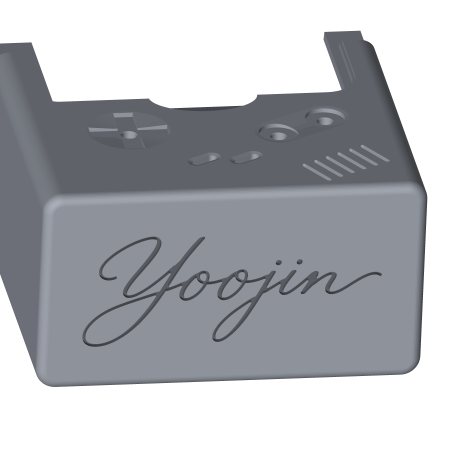
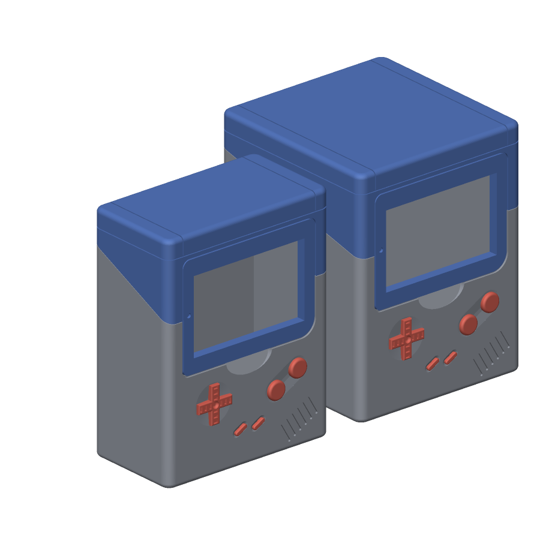
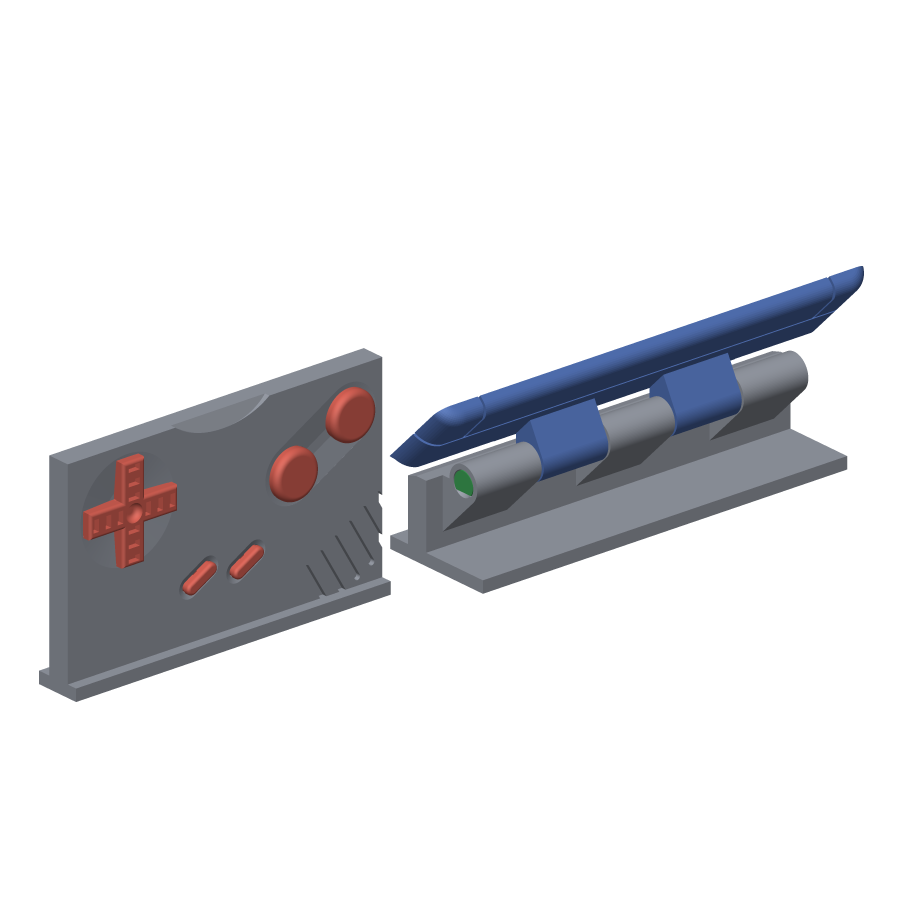
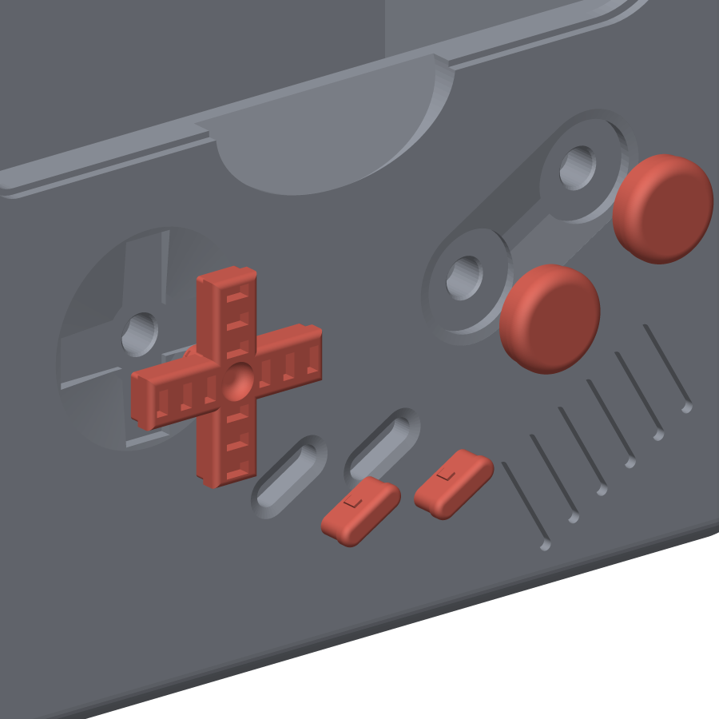

# Pokémon TCG Deckbox: Gameboy — by Ashwood

A 3D-printable Pokémon TCG deck box styled like a Game Boy. The listing says it holds **60 sleeved cards**, and the first card shows through the Game Boy "screen". In practice it's too short for sleeved cards; the [remix](#remix) below fixes that.

## Versions at a glance

Seven sets of files live in [stl/](stl/), each with its own README. Print the current remix unless you have a reason not to; for a 100-card deck, print the [100-card version](stl/100_deck_ver/).

[stl/pickachu/](stl/pickachu/) holds seven alternatives to round 5 with a Pikachu drawing engraved 0.8 mm into the back wall (a sitting Pikachu, and an all-over Pikachu-in-berries pattern upright, turned, or edge to edge with the engraving fading, the lines dropping out, or the drawing thinned but still joined at the edges), the last also with a Pokéball in the top of the lid; otherwise only the body differs. Its README has previews of every drawing on the back wall.

| | Original by Ashwood | Remix round 1 | Remix round 2 | Remix round 3 | Remix round 4 | Remix round 5 (current) | 100-card version |
|---|---|---|---|---|---|---|---|
| Files | [stl/original/](stl/original/) | [stl/remix/v1/](stl/remix/v1/) | [stl/remix/v2/](stl/remix/v2/) | [stl/remix/v3/](stl/remix/v3/) | [stl/remix/v4/](stl/remix/v4/) | [stl/remix/v5/](stl/remix/v5/) | [stl/100_deck_ver/](stl/100_deck_ver/) |
| Fits sleeved cards | No: 92 mm inside, the height of a sleeve | Yes: 96 mm inside | Yes: 96 mm inside | Yes: 96 mm inside | Yes: 96 mm inside | Yes: 96 mm inside | Yes: 96 mm inside |
| Inside (W × D × H) | 68 × 35 × 92 mm | 70 × 35 × 96 mm | 70 × 35 × 96 mm | 70 × 35 × 96 mm | 70 × 35 × 96 mm | 70 × 35 × 96 mm | 70 × 72 × 96 mm |
| Outside (W × D × H) | 76 × 43 × 96 mm | 78 × 43 × 100 mm | 78 × 43 × 100 mm | 78 × 43 × 100 mm | 78 × 43 × 100 mm | 78 × 43 × 100 mm | 78 × 80 × 100 mm |
| Capacity | About 60 sleeved cards | Same | Same | Same | Same | Same | About 100 double-sleeved cards |
| Hinge | Two small snap hinges | Five knuckles on a printed pin | Same as round 1 | Same as round 1 | Same as round 1 | Same, with the pin head flush in the end knuckle | Same as round 5 |
| Supports | Tree supports | None | None | None | None | None | None |
| Screen frame on the lid | 1.8 mm plate | 1.8 mm plate | 4 mm frame, flush inside | 4 mm frame, flush inside | 4 mm frame, flush inside | 4 mm frame, flush inside | 4 mm frame, flush inside |
| Holds the lid shut | Friction only | Friction only | Two snap catches | Two snap catches | Two snap catches | Two snap catches | Two snap catches |
| Grip for opening | The window | The window | Thumb notch under the lid | Thumb notch under the lid | Thumb notch under the lid | Thumb notch under the lid | Thumb notch under the lid |
| Lid's inner edges | Square | Square | Lead-in chamfers | Lead-in chamfers | Lead-in chamfers | Lead-in chamfers | Lead-in chamfers |
| Engraved in the bottom | "Ashwood" | "Ashwood" | "Ashwood" | "Yoojin", in script | "Yoojin", in script | "Yoojin", in script, 0.8 mm deep | "Yoojin", in script, 0.8 mm deep |
| D-pad and buttons | The designer's: drawn the exact size of their seats, forced in | Same | Same | Same | Redrawn: 0.15 mm clearance, held by small ribs | Same as round 4 | Same as round 4 |
| Fit-test coupons | None | None | None | None | None | Three, cut from the real files: the button seats and the hinge | The same three as round 5 |
| Parts to print | 5 | 6 (adds the pin) | 6 | 6 | 6 | 6, plus 3 optional test coupons | 6, plus 3 optional test coupons |
| Test-printed | Yes, by the designer | No | No | No | No | No | No |

The D-pad and buttons are the designer's up to round 3. Round 4 redraws the parts of them that sit inside the front wall so they push in by hand; the seats in the body are the same in every version, so the round-4 buttons also fit the earlier bodies and the original. Round 5 changes nothing you see from the front: it makes the engraving shallower and free of tiny islands, sinks the pin's head into the hinge, and adds three small coupons for testing the fits before the long prints. The 100-card version is round 5 made 37 mm deeper, for a 100-card deck in double sleeves; nothing but the depth changes.

## Source

| | |
|---|---|
| **Model** | Pokemon tcg deckbox: Gameboy |
| **Designer** | [Ashwood](https://makerworld.com/en/@Ashwood/profile) |
| **Link** | https://makerworld.com/en/models/828343 |
| **Platform** | MakerWorld (Bambu Lab) |
| **License** | MakerWorld Standard Digital File License (from the 3MF metadata). Check its terms on the listing before sharing the files or selling prints. |

## Print settings (from the listing)

- **Layer height:** 0.2 mm
- **Walls:** 2
- **Infill:** 10% (the designer's example used 20% gyroid)
- **Material:** the designer's example was printed in Mountain Dew Yellow PETG
- **Supports:** tree supports are on in the 3MF profile

One commenter reported a layer-shift gap. The designer said that was printer calibration, not the profile.

**Assembly tip from the designer:** to connect the hinges, use minimal force but apply it steadily.

The listing has 10 print files/profiles, including a 100-card version.

## Files

Downloaded from the MakerWorld listing into [stl/original/](stl/original/):

| File | Contents |
|---|---|
| [Case-bottom.stl](stl/original/Case-bottom.stl) | Main body that holds the cards |
| [Case-top.stl](stl/original/Case-top.stl) | Hinged lid with the screen bezel |
| [D-Pad.stl](stl/original/D-Pad.stl) | D-pad |
| [Button.stl](stl/original/Button.stl) | A/B buttons |
| [StartSelect.stl](stl/original/StartSelect.stl) | Start/Select buttons |
| [Case-GB.3mf](stl/original/Case-GB.3mf) | Bambu Studio project with all parts on one plate and the print profile |
| [Pokemon+tcg+deckbox_+Gameboy.zip](stl/original/Pokemon+tcg+deckbox_+Gameboy.zip) | The five STLs above in one archive |

The 3MF's part names are in Dutch: *Deksel* is the lid, *KnopAB* the A/B buttons, and *KnopStartSelect* the Start/Select buttons.

## Images

Photos from the MakerWorld listing, by Ashwood.

| Closed | Open |
|---|---|
|  |  |
|  |  |

## Remix

A modified version of Ashwood's box that fits sleeved cards, has a stronger hinge, and prints without supports. The depth is unchanged, so it still holds about 60 sleeved cards. A second round of changes makes the screen frame 4 mm thick, adds snap catches that hold the lid shut, a thumb notch for opening, and lead-in chamfers so the closing lid can't catch a card. A third round replaces the designer's signature engraved in the bottom with "Yoojin" in script. A fourth redraws the D-pad and buttons, which were the exact size of their seats and had to be forced in, so they push into the front by hand. A fifth round makes the engraving safer to print, recesses the pin head into the hinge, and adds three fit-test coupons. Every fix is documented in detail in [improvements.md](improvements.md). A 100-card version of the current remix, 37 mm deeper, is in [stl/100_deck_ver/](stl/100_deck_ver/); see [100-card version](#100-card-version).

### What's wrong with the original

- **Too short for sleeved cards.** The inside is exactly 92.0 mm from floor to lid ceiling. Standard sleeves are 91–92 mm tall (2⅝ × 3⅝ in is 92.1 mm), which leaves no room for differences between sleeve brands or for print tolerance. The width has 2 mm of clearance (68 mm for 66 mm sleeves), but the height has none.
- **Fragile hinge.** Each of the two hinges is a lid tab with a 0.75 mm wall around a 2 mm hole, held by snap bumps that engage only 0.5 mm.
- **Needs supports.** The profile uses tree supports for the hinge parts and the inside of the lid's back wall.

### What changed

| | Original | Remix |
|---|---|---|
| Inside (W × D × H) | 68 × 35 × 92 mm | 70 × 35 × 96 mm |
| Outside (W × D × H) | 76 × 43 × 96 mm | 78 × 43 × 100 mm |
| Hinge | Two snap hinges, sticking out 4.3 mm at the back | Five 6 mm knuckles on a printed pin, sticking out 7.5 mm |
| Supports | Tree supports | None |
| Screen frame on the lid | 1.8 mm plate | 4 mm frame, flush with the inside of the front wall |
| Closure | Friction only | Two snap catches in the side seams |
| Opening | Nothing to grip but the window | Thumb notch under the lid's bottom edge |
| Lid's inner edges | Square | Lead-in chamfers at the front, sides and back |
| Engraved in the bottom | "Ashwood" in blackletter, 41 × 10 mm, 1 mm deep | "Yoojin" in script, 60 × 24 mm, 0.8 mm deep |
| D-pad and buttons | The exact size of their seats; the designer suggests a butter knife to push Start and Select in | 0.15 mm clearance all round; the D-pad and A/B held by crush-rib pegs, Start and Select by a rib on each side |
| Hinge pin | None: snap hinges | 58.5 mm octagonal pin with a 4 mm round head, flush in a recess in the left knuckle; a knock-out hole in the right one lets a paperclip push it out |
| Fit tests | None | Three coupons cut from the real files: the five button seats, and the hinge with its pin |

- The extra 4 mm of height is all in the lid, above the screen, so the screen still frames the same part of the card.
- The extra width is 1 mm on each side, so the screen, D-pad and buttons stay where they were.
- The front details and the lid's light friction fit along the side seams are unchanged.
- The screen frame, catches, notch and chamfers are the second round of changes; see [improvements.md](improvements.md#round-2) sections 6 to 9. The engraving in the bottom is the third; see [section 10](improvements.md#10-signature-in-the-bottom). The buttons are the fourth; see [section 11](improvements.md#11-buttons). The engraving depth, the recessed pin head and the coupons are the fifth; see [sections 12 to 14](improvements.md#round-5).

### Remix files

| File | Print orientation |
|---|---|
| [Case-bottom_remix.stl](stl/remix/v5/Case-bottom_remix.stl) | Upright, open top facing up |
| [Case-top_remix.stl](stl/remix/v5/Case-top_remix.stl) | Front face (screen bezel) on the bed |
| [Hinge-pin_remix.stl](stl/remix/v5/Hinge-pin_remix.stl) | Lying on its flat side |
| [D-Pad_remix.stl](stl/remix/v5/D-Pad_remix.stl) | Face down, peg up |
| [Button_remix.stl](stl/remix/v5/Button_remix.stl) | Face down, peg up; print two (A and B) |
| [StartSelect_remix.stl](stl/remix/v5/StartSelect_remix.stl) | Standing on its back face; print two |
| [Test-seats.stl](stl/remix/v5/Test-seats.stl) | Optional coupon: upright on its foot |
| [Test-hinge-body.stl](stl/remix/v5/Test-hinge-body.stl) | Optional coupon: upright on its foot |
| [Test-hinge-lid.stl](stl/remix/v5/Test-hinge-lid.stl) | Optional coupon: cut face on the bed |

All nine STLs are already oriented for printing; the three coupons are optional, see [Test the fits first](#test-the-fits-first). The earlier rounds are kept: [stl/remix/v4/](stl/remix/v4/) is the same box with the 1 mm engraving and the pin head standing proud of the hinge, [stl/remix/v3/](stl/remix/v3/) is the box with the designer's press-fit buttons, [stl/remix/v2/](stl/remix/v2/) has Ashwood's signature in the bottom, and [stl/remix/v1/](stl/remix/v1/) is from before the screen frame, catches, notch and chamfers. Each folder has a README with its own file list and settings.

### 100-card version

[stl/100_deck_ver/](stl/100_deck_ver/) is the round-5 box made 37 mm deeper: 70 × 72 × 96 mm inside and 78 × 80 × 100 mm outside, for 100 cards in double sleeves (a perfect-fit inner sleeve and a standard outer sleeve; oversized 69 × 94 mm outer sleeves don't fit any version of this box). The front, buttons, hinge, pin, catches and engraving are the same, so everything below applies to it too. Its body needs an 80 × 80 mm footprint and its lid prints 87 mm tall; the pin, buttons and coupons are the same files. The sloping side seam runs between the same front and back points, so it is gentler, and the lid's friction strips along the seams are twice as long, so the lid may feel a little firmer to open. Details are in the folder's [README](stl/100_deck_ver/README.md) and in [improvements.md](improvements.md#100-card-version).

### Recommended print settings

Turn supports **off** for every part. Apart from the tops of small holes and the lid's back-wall bridge, no overhang is shallower than 45°. The second-round features need nothing extra: the thick screen frame lies on the bed, the catch grooves and chamfers are vertical or at 45°, and the notch and the catch beads on the body are small.

| Setting | Body and lid | Hinge pin | D-pad and buttons |
|---|---|---|---|
| Layer height | 0.2 mm, as in the original profile | 0.12–0.16 mm, so the pin comes out closer to size (easiest on its own plate) | 0.12–0.16 mm, so the ribs come out true (put them on the pin's plate) |
| Walls | 2–3 | 2 | 2 |
| Infill | 10–15% | 100% | 100% |
| Brim | Not needed | Recommended: the pin rests on a flat side only 1 mm wide | Start and Select: yes, they stand on a 5 × 2 mm footprint |
| Material | PLA or PETG | PLA or PETG | PLA or PETG |

- **Bridge:** the inside of the lid's back wall prints as one 70 mm bridge. It's hidden inside the lid and set back 1 mm, so a little sag can't touch the cards. If your printer bridges poorly (PETG often does), turn on thick bridges in the slicer.
- **Engraving:** "Yoojin" is cut 0.8 mm into the face that sits on the bed, with its thinnest strokes 0.6 mm wide. A first layer squashed too hard closes them up, so level the bed and leave the slicer's elephant-foot compensation on.
- **Spare pin:** the pin is small, so print two.
- **Brim cleanup:** trim the pin's brim cleanly so no edge catches in the hinge holes.
- **Bezel color:** STLs carry no color. To get the black bezel back, paint it in Bambu Studio, as in the original 3MF.
- **Pin fit:** if the pin comes out too tight or too loose, see the tuning tips under [Hinge assembly](#hinge-assembly).
- **Unsure about the fits?** Print the three coupons first; see the next section.
- **100-card version:** the same settings. Its body is 80 mm deep and its lid stands 87 mm tall on the bed.

### Test the fits first

Every press fit in this box depends on how your printer makes small holes, and the body takes about five hours to print. Three coupons, cut from the real files, test the fits in under an hour: Test-seats is the front wall with all five button seats on a foot, Test-hinge-body is the top of the back wall with the three body knuckles, the pin recess and the knock-out hole, and Test-hinge-lid is the lid's back wall with its two knuckles. Print them with the pin and one of each button (about 20 cm³, against 90 cm³ for the body and lid), in the same orientations and settings as the parts they come from.

- **Buttons:** push the D-pad, an A/B button and a Start/Select button into the seats coupon. They should go in with a thumb and stay put. If a peg won't go in, the holes printed small: drill the body's two peg holes to 3 mm when you print it, or sand the ribs. If a button is loose, plan on a drop of glue.
- **Hinge:** set the lid strip on the body strip so the knuckles interleave and push the pin in at the end with the round recess until the head is flush. The lid strip should swing freely through about 160° before it meets the foot. Too tight: scale the pin's width and height to 97 % for the real print, or plan on a 2.8 mm drill through the body knuckles. Turns too easily in the body strip: scale to 102 %. Push it out again with a straightened paperclip through the small hole at the other end.

The coupons test the seats and the hinge, not the snap catches or the lid's friction fit, which need the full parts.

### Opening and closing

- **To open:** put a thumb in the notch under the screen and push the lid's bottom edge up and forward. Don't hook a finger through the window: when the box is full, the front card sits right behind it.
- **To close:** swing the lid down until it clicks. Two small beads on the body's side walls, 17 mm behind the front face, click into grooves in the lid and hold it shut when the box is tipped or carried.
- **If the click is too stiff,** lightly sand the two beads. They sit on the raised inner layer of each side wall, just above the seam. **If it's too loose,** a coat of paint or glue on the beads brings it back. The beads are 0.3 mm tall, so small changes matter.

| Catch bead on the body | Catch groove in the lid |
|---|---|
|  |  |

### Fitting the buttons

The buttons go in before the lid. Each slides into its seat with 0.15 mm to spare and is held by small ribs that press in as it goes home:

- **D-pad and A/B:** the peg on the back has four ribs that press into the 3 mm hole. Line the peg up with the hole and push with a thumb until the button sits flat in its seat. The D-pad only fits one way round.
- **Start and Select:** a rib on each long side presses against the seat walls. They are small, so push them in with a fingertip or the flat of a knife until they stop on the seat floor, 2 mm in.
- **Too tight:** the holes in the body print a little undersize on some machines. Run a 3 mm drill bit through the two peg holes, or lightly sand the ribs. **Too loose:** a drop of glue on the ribs.
- The buttons can be pushed out again from inside the box, through the peg holes.

The buttons' seats are the same in every version, so these buttons also fit the earlier bodies and the designer's.

### Hinge assembly

1. Close the lid so the knuckles line up.
2. Looking at the back of the box, push the pin into the left end (the knuckle with the round recess), tip first, until its head sits flush in the recess.
3. That's it. The body's 2.8 mm holes grip the pin, and the lid's 3.1 mm holes let the lid swing freely.

If the pin is too tight, scale its width and height (not its length) to 97% in the slicer and reprint, or run a 2.8 mm drill bit through the body knuckles. If it's loose, scale those two to 102% or put a drop of glue on the head. The head sits flush, so to take the lid off, push the pin out from the other end with a straightened paperclip through the 1.6 mm hole in the right-hand knuckle. The lid swings back about 210° before it touches the box.

| Open | Hinge |
|---|---|
|  |  |

Renders: grey is the body, blue is the lid, green is the pin.

## Related

- Ashwood's other deck boxes, including *Pokémon tcg deckbox: Simple*, are on their [MakerWorld profile](https://makerworld.com/en/@Ashwood/profile).
- Other creators have remixed this design, including a Game Boy Color version.
