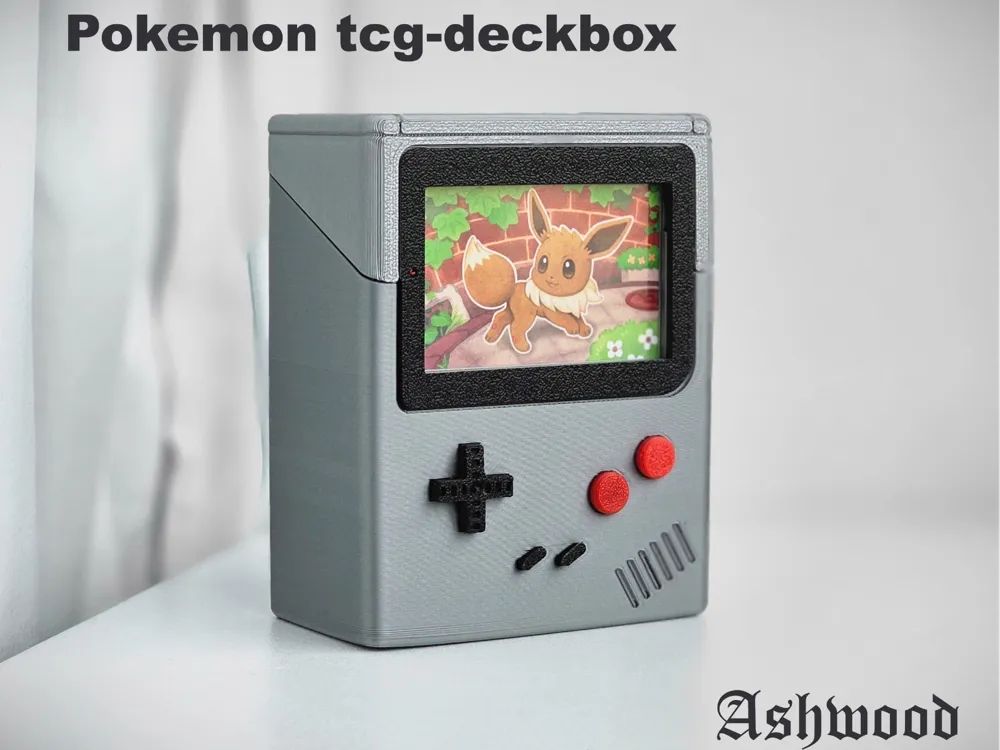
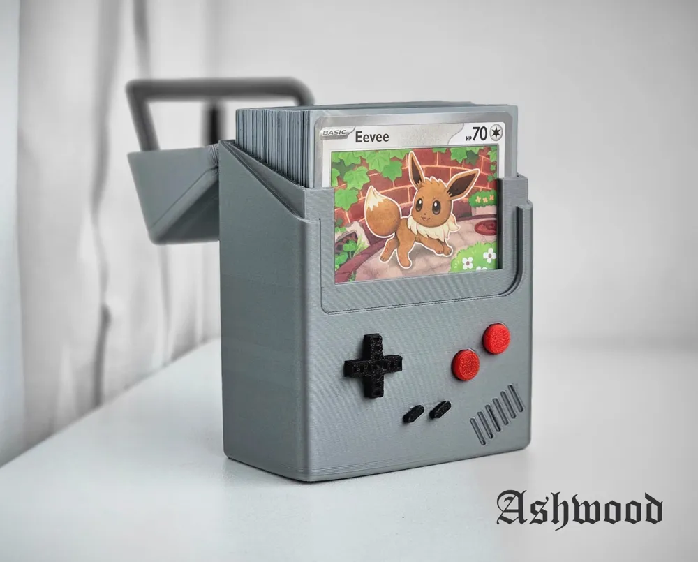
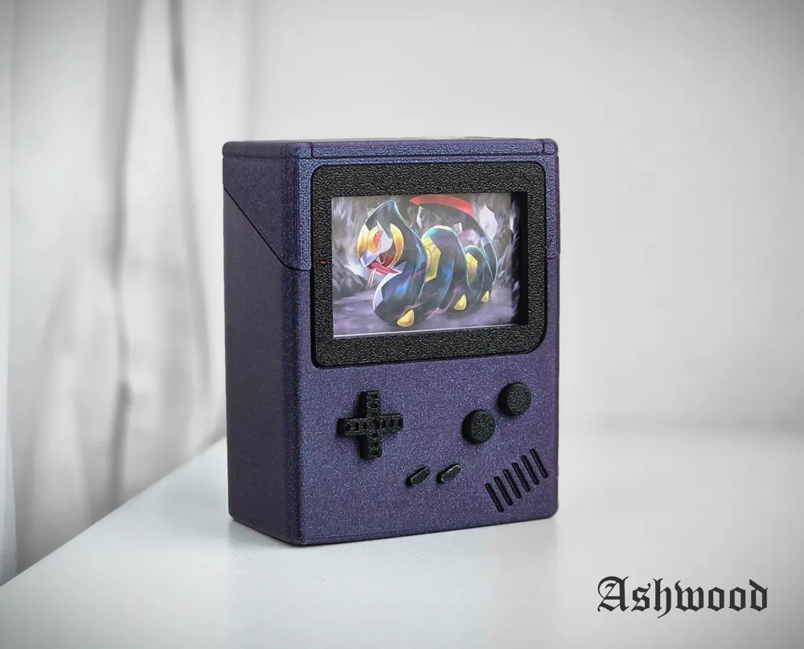
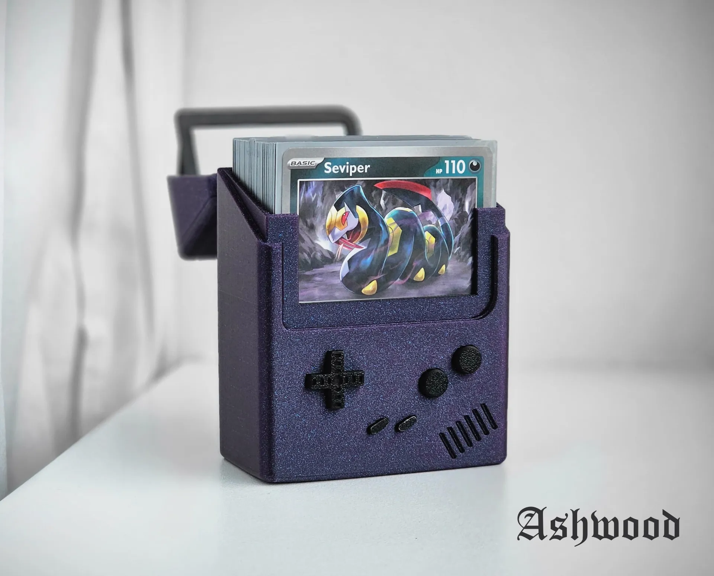
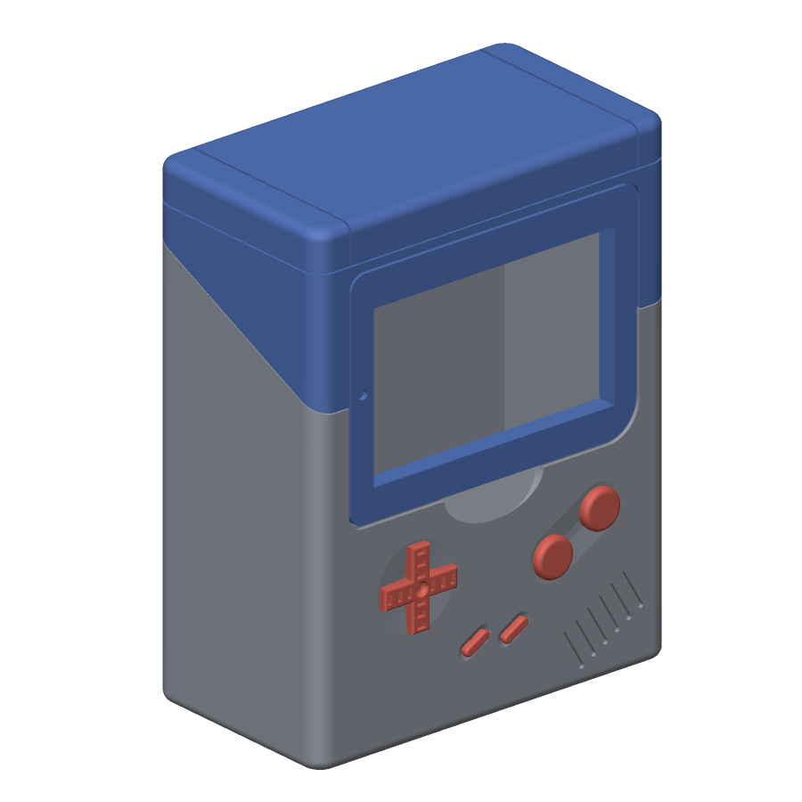
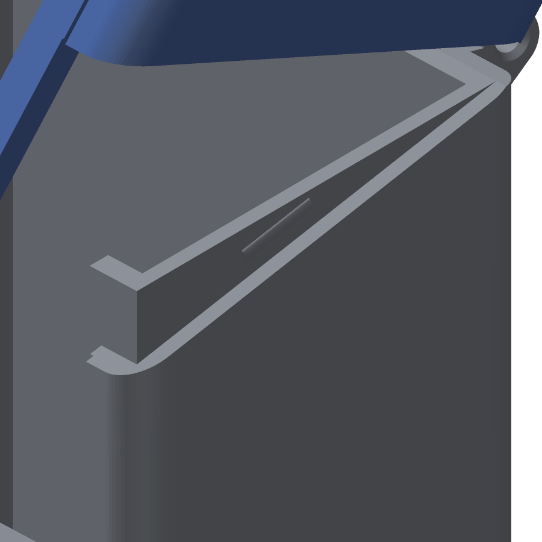
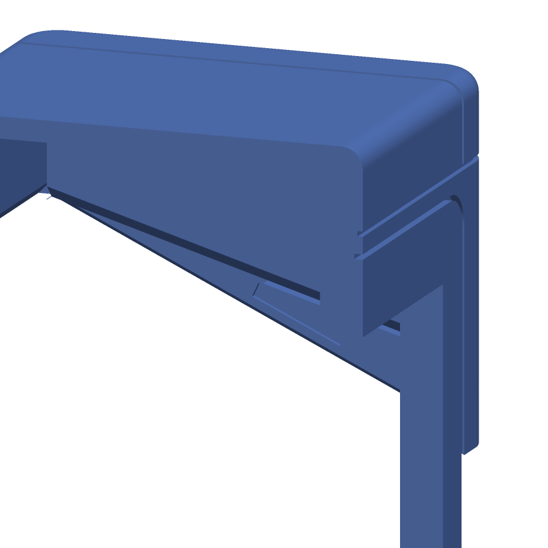
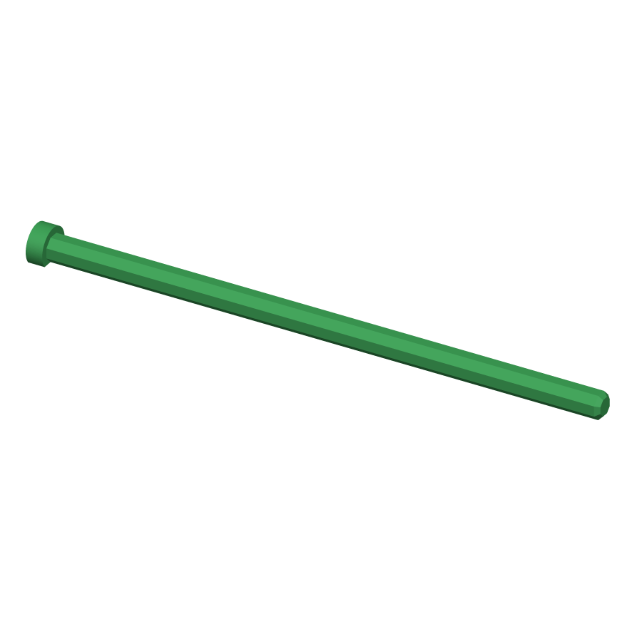
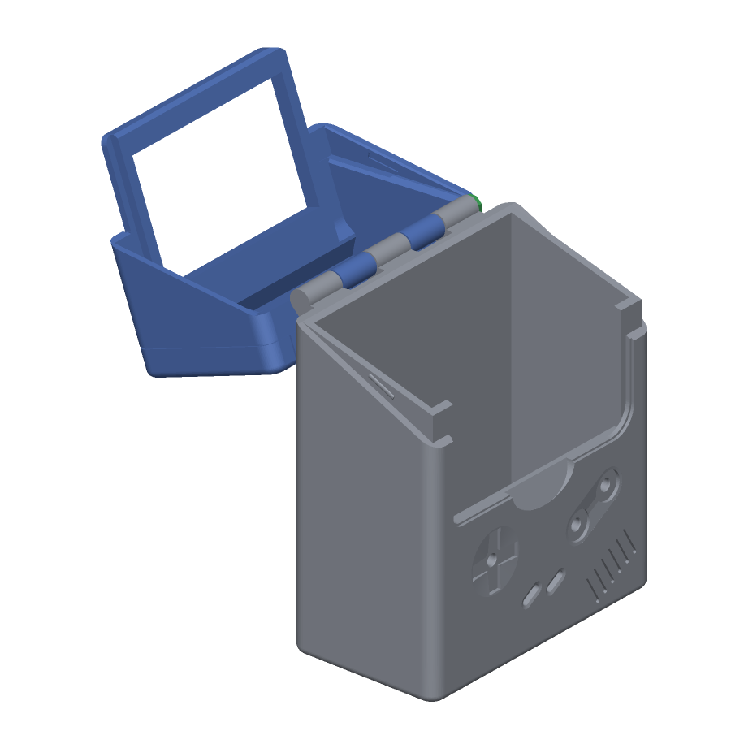
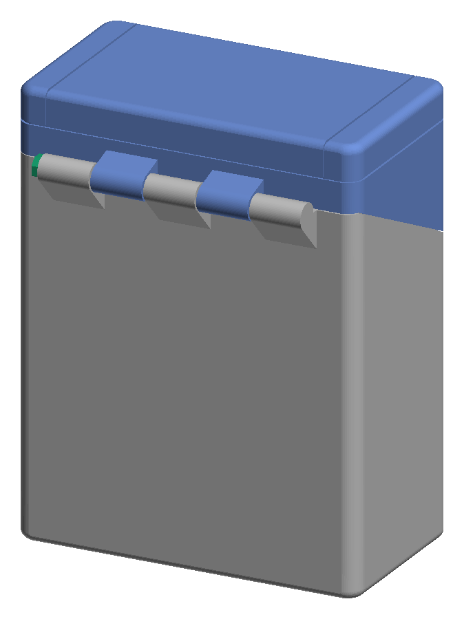

# Pokémon TCG Deckbox: Gameboy — by Ashwood

A 3D-printable Pokémon TCG deck box styled like a Game Boy. The listing says it holds **60 sleeved cards**, and the first card shows through the Game Boy "screen". In practice it's too short for sleeved cards; the [remix](#remix) below fixes that.

## Versions at a glance

Three sets of files live in [stl/](stl/), each with its own README. Print the current remix unless you have a reason not to.

| | Original by Ashwood | Remix round 1 | Remix round 2 (current) |
|---|---|---|---|
| Files | [stl/original/](stl/original/) | [stl/remix/v1/](stl/remix/v1/) | [stl/remix/](stl/remix/v2/) |
| Fits sleeved cards | No: 92 mm inside, the height of a sleeve | Yes: 96 mm inside | Yes: 96 mm inside |
| Inside (W × D × H) | 68 × 35 × 92 mm | 70 × 35 × 96 mm | 70 × 35 × 96 mm |
| Outside (W × D × H) | 76 × 43 × 96 mm | 78 × 43 × 100 mm | 78 × 43 × 100 mm |
| Capacity | About 60 sleeved cards | Same | Same |
| Hinge | Two small snap hinges | Five knuckles on a printed pin | Same as round 1 |
| Supports | Tree supports | None | None |
| Screen frame on the lid | 1.8 mm plate | 1.8 mm plate | 4 mm frame, flush inside |
| Holds the lid shut | Friction only | Friction only | Two snap catches |
| Grip for opening | The window | The window | Thumb notch under the lid |
| Lid's inner edges | Square | Square | Lead-in chamfers |
| Parts to print | 5 | 6 (adds the pin) | 6 |
| Test-printed | Yes, by the designer | No | No |

The D-pad and buttons are the designer's in every version.

## Source

| | |
|---|---|
| **Model** | Pokemon tcg deckbox: Gameboy |
| **Designer** | [Ashwood](https://makerworld.com/en/@Ashwood/profile) |
| **Link** | https://makerworld.com/en/models/828343 |
| **Platform** | MakerWorld (Bambu Lab) |
| **License** | MakerWorld Standard Digital File License (from the 3MF metadata). Check its terms on the listing before sharing the files or selling prints. |

## Print settings (from the listing)

- **Layer height:** 0.2 mm
- **Walls:** 2
- **Infill:** 10% (the designer's example used 20% gyroid)
- **Material:** the designer's example was printed in Mountain Dew Yellow PETG
- **Supports:** tree supports are on in the 3MF profile

One commenter reported a layer-shift gap. The designer said that was printer calibration, not the profile.

**Assembly tip from the designer:** to connect the hinges, use minimal force but apply it steadily.

The listing has 10 print files/profiles, including a 100-card version.

## Files

Downloaded from the MakerWorld listing into [stl/original/](stl/original/):

| File | Contents |
|---|---|
| [Case-bottom.stl](stl/original/Case-bottom.stl) | Main body that holds the cards |
| [Case-top.stl](stl/original/Case-top.stl) | Hinged lid with the screen bezel |
| [D-Pad.stl](stl/original/D-Pad.stl) | D-pad |
| [Button.stl](stl/original/Button.stl) | A/B buttons |
| [StartSelect.stl](stl/original/StartSelect.stl) | Start/Select buttons |
| [Case-GB.3mf](stl/original/Case-GB.3mf) | Bambu Studio project with all parts on one plate and the print profile |
| [Pokemon+tcg+deckbox_+Gameboy.zip](stl/original/Pokemon+tcg+deckbox_+Gameboy.zip) | The five STLs above in one archive |

The 3MF's part names are in Dutch: *Deksel* is the lid, *KnopAB* the A/B buttons, and *KnopStartSelect* the Start/Select buttons.

## Images

Photos from the MakerWorld listing, by Ashwood.

| Closed | Open |
|---|---|
|  |  |
|  |  |

## Remix

A modified version of Ashwood's box that fits sleeved cards, has a stronger hinge, and prints without supports. The depth is unchanged, so it still holds about 60 sleeved cards. A second round of changes makes the screen frame 4 mm thick, adds snap catches that hold the lid shut, a thumb notch for opening, and lead-in chamfers so the closing lid can't catch a card. Every fix is documented in detail in [improvements.md](improvements.md).

### What's wrong with the original

- **Too short for sleeved cards.** The inside is exactly 92.0 mm from floor to lid ceiling. Standard sleeves are 91–92 mm tall (2⅝ × 3⅝ in is 92.1 mm), which leaves no room for differences between sleeve brands or for print tolerance. The width has 2 mm of clearance (68 mm for 66 mm sleeves), but the height has none.
- **Fragile hinge.** Each of the two hinges is a lid tab with a 0.75 mm wall around a 2 mm hole, held by snap bumps that engage only 0.5 mm.
- **Needs supports.** The profile uses tree supports for the hinge parts and the inside of the lid's back wall.

### What changed

| | Original | Remix |
|---|---|---|
| Inside (W × D × H) | 68 × 35 × 92 mm | 70 × 35 × 96 mm |
| Outside (W × D × H) | 76 × 43 × 96 mm | 78 × 43 × 100 mm |
| Hinge | Two snap hinges, sticking out 4.3 mm at the back | Five 6 mm knuckles on a printed pin, sticking out 7.5 mm |
| Supports | Tree supports | None |
| Screen frame on the lid | 1.8 mm plate | 4 mm frame, flush with the inside of the front wall |
| Closure | Friction only | Two snap catches in the side seams |
| Opening | Nothing to grip but the window | Thumb notch under the lid's bottom edge |
| Lid's inner edges | Square | Lead-in chamfers at the front, sides and back |

- The extra 4 mm of height is all in the lid, above the screen, so the screen still frames the same part of the card.
- The extra width is 1 mm on each side, so the screen, D-pad and buttons stay where they were.
- The front details, the signature on the bottom, and the lid's light friction fit along the side seams are unchanged.
- The screen frame, catches, notch and chamfers are the second round of changes; see [improvements.md](improvements.md#round-2) sections 6 to 9.

### Remix files

| File | Print orientation |
|---|---|
| [Case-bottom_remix.stl](stl/remix/v2/Case-bottom_remix.stl) | Upright, open top facing up |
| [Case-top_remix.stl](stl/remix/v2/Case-top_remix.stl) | Front face (screen bezel) on the bed |
| [Hinge-pin_remix.stl](stl/remix/v2/Hinge-pin_remix.stl) | Lying on one of its flat sides |

All three STLs are already oriented for printing. The D-pad and buttons are unchanged, so print them from [Case-GB.3mf](stl/original/Case-GB.3mf) or the original STLs. The first-round files, before the screen frame, catches, notch and chamfers, are kept in [stl/remix/v1/](stl/remix/v1/). Each folder has a README with its own file list and settings.

### Recommended print settings

Turn supports **off** for all three parts. Apart from the tops of small holes and the lid's back-wall bridge, no overhang is shallower than 45°. The second-round features need nothing extra: the thick screen frame lies on the bed, the catch grooves and chamfers are vertical or at 45°, and the notch and the catch beads on the body are small.

| Setting | Body and lid | Hinge pin |
|---|---|---|
| Layer height | 0.2 mm, as in the original profile | 0.12–0.16 mm, so the pin comes out closer to size (easiest on its own plate) |
| Walls | 2–3 | 2 |
| Infill | 10–15% | 100% |
| Brim | Not needed | Recommended: the pin rests on a flat side only 1 mm wide |
| Material | PLA or PETG | PLA or PETG |

- **Bridge:** the inside of the lid's back wall prints as one 70 mm bridge. It's hidden inside the lid and set back 1 mm, so a little sag can't touch the cards. If your printer bridges poorly (PETG often does), turn on thick bridges in the slicer.
- **Spare pin:** the pin is small, so print two.
- **Brim cleanup:** trim the pin's brim cleanly so no edge catches in the hinge holes.
- **Bezel color:** STLs carry no color. To get the black bezel back, paint it in Bambu Studio, as in the original 3MF.
- **Pin fit:** if the pin comes out too tight or too loose, see the tuning tips under [Hinge assembly](#hinge-assembly).

### Opening and closing

- **To open:** put a thumb in the notch under the screen and push the lid's bottom edge up and forward. Don't hook a finger through the window: when the box is full, the front card sits right behind it.
- **To close:** swing the lid down until it clicks. Two small beads on the body's side walls, 17 mm behind the front face, click into grooves in the lid and hold it shut when the box is tipped or carried.
- **If the click is too stiff,** lightly sand the two beads. They sit on the raised inner layer of each side wall, just above the seam. **If it's too loose,** a coat of paint or glue on the beads brings it back. The beads are 0.3 mm tall, so small changes matter.

| Catch bead on the body | Catch groove in the lid |
|---|---|
|  |  |

### Hinge assembly

1. Close the lid so the knuckles line up.
2. Looking at the back of the box, push the pin into the left end (the countersunk hole), tip first, until its head sits against the knuckle.
3. That's it. The body's 2.8 mm holes grip the pin, and the lid's 3.1 mm holes let the lid swing freely.

If the pin is too tight, scale its width and height (not its length) to 97% in the slicer and reprint, or run a 2.8 mm drill bit through the body knuckles. If it's loose, scale those two to 102% or put a drop of glue under the head. To take the lid off, pull the pin out by its head. The lid swings back about 210° before it touches the box.

| Open | Hinge |
|---|---|
|  |  |

Renders: grey is the body, blue is the lid, green is the pin.

## Related

- Ashwood's other deck boxes, including *Pokémon tcg deckbox: Simple*, are on their [MakerWorld profile](https://makerworld.com/en/@Ashwood/profile).
- Other creators have remixed this design, including a Game Boy Color version.
