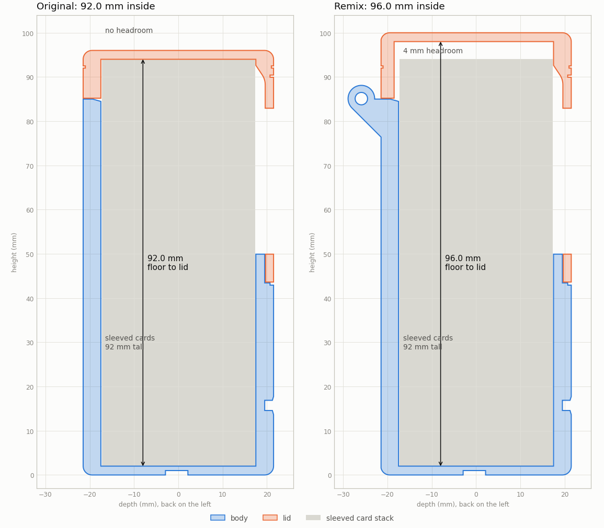
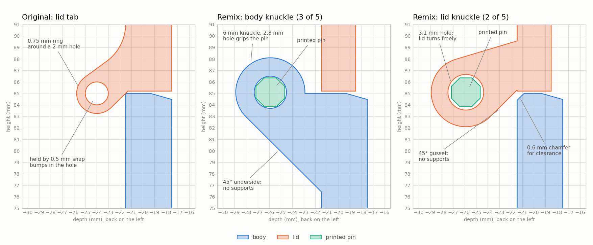
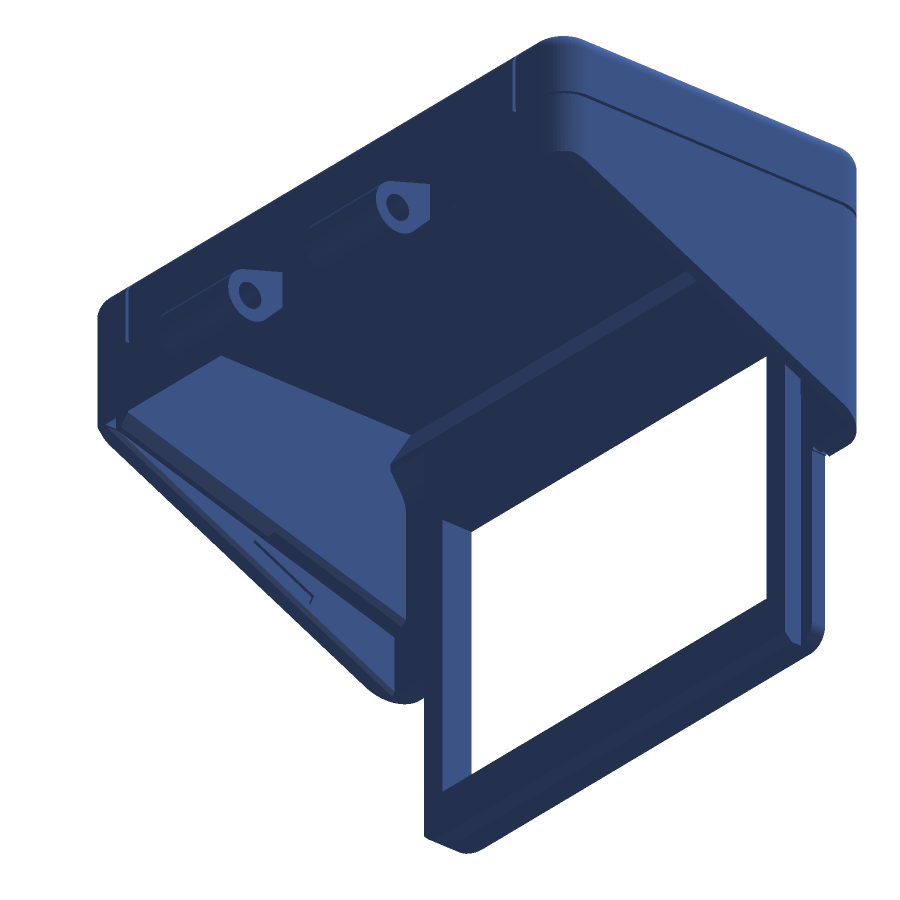
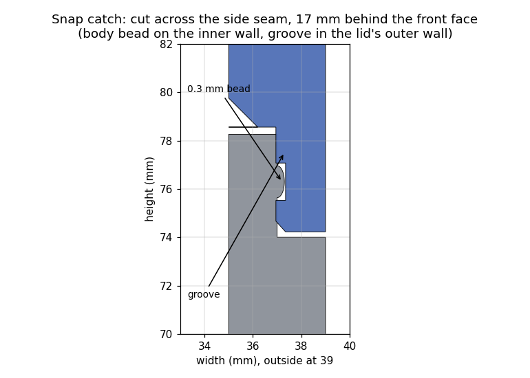
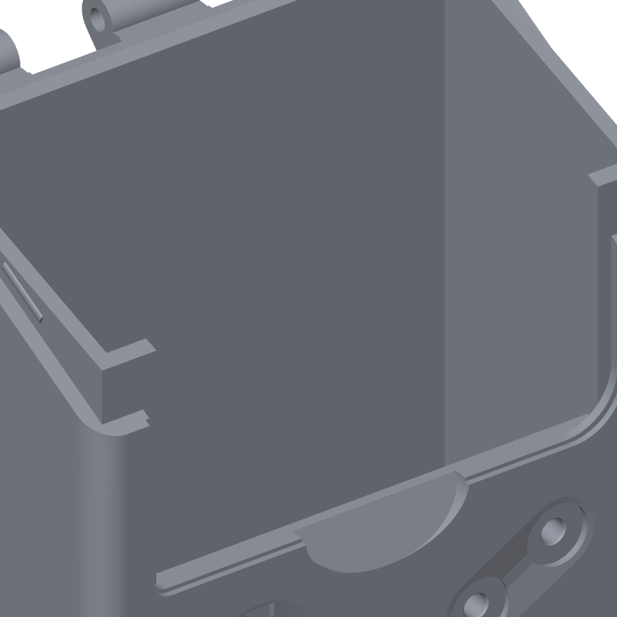
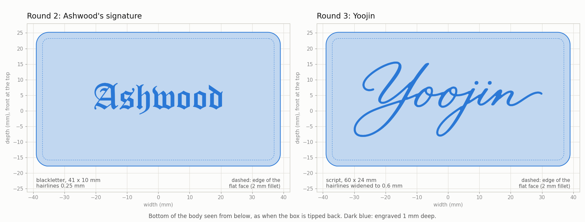
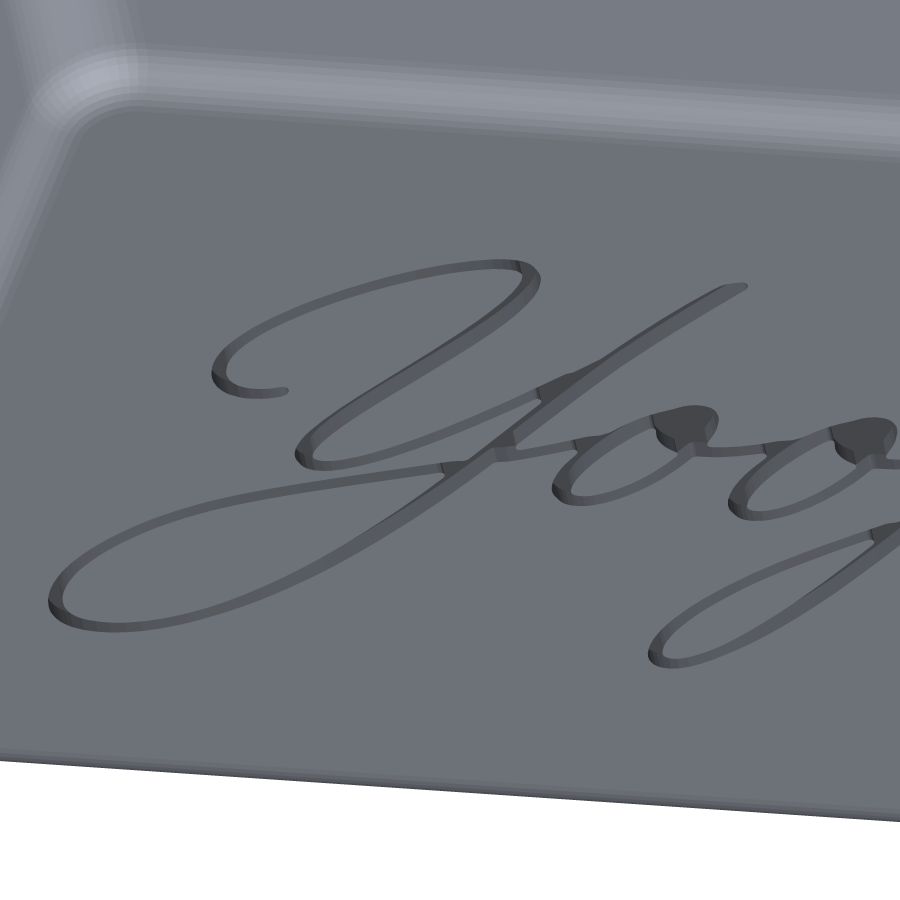
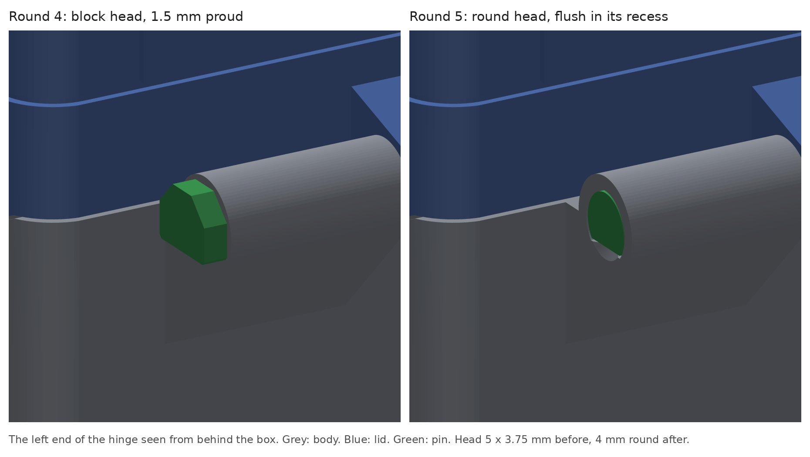
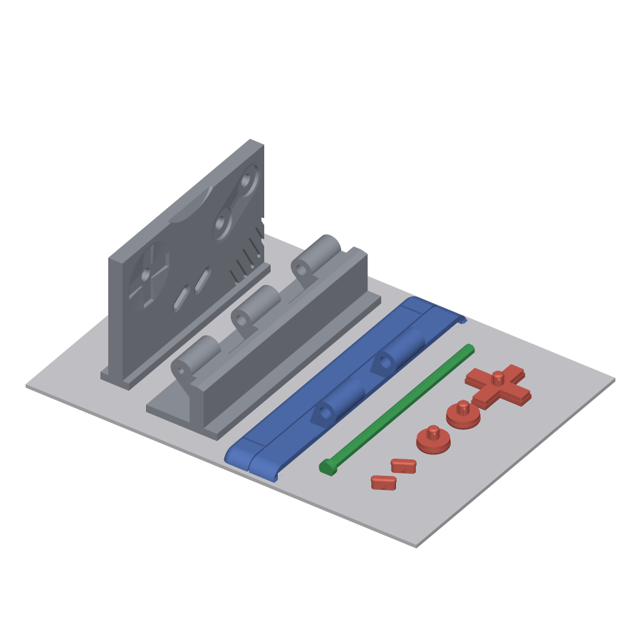

# Improvements to the Game Boy deck box

This documents every change in the remix of Ashwood's [Pokemon tcg deckbox: Gameboy](https://makerworld.com/en/models/828343). It covers what was wrong with the original, what changed, and how the result was checked. The remix files are in [stl/remix/](stl/remix/v5/), and the [README](README.md#remix) covers printing and assembly. Sections 1 to 5 are the first round (fit, hinge, printing). Sections 6 to 9 are a [second round](#round-2) made on top of it, from feedback on the first; the first-round files are kept in [stl/remix/v1/](stl/remix/v1/). Section 10 is a [third round](#round-3) that changes only the signature engraved in the bottom; the second-round files, with Ashwood's signature, are kept in [stl/remix/v2/](stl/remix/v2/). Section 11 is a [fourth round](#round-4) that redraws the D-pad and buttons so they push in by hand; the third-round files, with the designer's buttons, are kept in [stl/remix/v3/](stl/remix/v3/). Sections 12 to 14 are a [fifth round](#round-5): a shallower engraving with no tiny islands, the pin head recessed into the hinge, and three fit-test coupons; the fourth-round files are kept in [stl/remix/v4/](stl/remix/v4/).

## Summary

| # | Problem in the original | Fix |
|---|---|---|
| 1 | Inside is 92.0 mm tall, the same as a sleeved card | 4 mm more height in the lid: 96.0 mm inside |
| 2 | 1 mm per side for 66–67 mm sleeves | 1 mm more per side: 70.0 mm inside |
| 3 | Fragile snap hinges | Five-knuckle hinge with a printed pin |
| 4 | Needs supports | Prints with supports off |
| 5 | STLs lie on their side in a slicer | STLs exported in print orientation |
| 6 | The lid's screen frame is a 1.8 mm plate hanging 23 mm below the lid walls; it flexes | 4 mm thick frame, about 11× stiffer, flush with the inside of the front wall |
| 7 | Nothing holds the lid shut | Two snap catches in the side seams |
| 8 | The only grip for opening is the window, with the front card behind it | Thumb notch under the lid's bottom edge |
| 9 | Square inner edges on the lid catch cards that sit at an angle | Lead-in chamfers all round the lid's inner rim |
| 10 | The bottom is engraved with the designer's signature, "Ashwood" | "Yoojin" in script, engraved the same 1 mm deep |
| 11 | The D-pad and buttons are drawn the exact size of their seats and have to be forced in | 0.15 mm of clearance, held by crush ribs on the pegs and on the Start/Select pills |
| 12 | The engraving's two smallest loops are 1.3 mm islands of first layer, 1 mm tall, that a nozzle can knock off | Engraving 0.8 mm deep with loops under 3 mm² filled: no island under 2.4 mm |
| 13 | The pin's head stands 1.5 mm proud of the hinge | 4 mm round head, flush in a recess in the end knuckle; knock-out hole at the other end |
| 14 | Every press fit depends on the printer, and finding out takes a five-hour body print | Three coupons cut from the real files test the buttons and the hinge in under an hour |

## 1. Interior height: 92 → 96 mm

**Problem.** The inside measures exactly 92.0 mm from floor to lid ceiling, at every point across the box. Standard sleeves are 91–92 mm tall (2⅝ × 3⅝ in is 92.1 mm), so there's no allowance for differences between sleeve brands or for print tolerance. In a test print, sleeved cards didn't fit. The width got 2 mm of clearance, but the height got none.

**Fix.** 4 mm of height was added to the lid only, just under its ceiling and above the screen. Only straight vertical walls pass through that band, so the extra height is a plain extension and nothing else changes shape. The body is untouched.

**Result.** 96.0 mm inside, measured at 9 points across the footprint. That leaves about 4 mm of headroom over a 92 mm sleeve. Cards still sit on the same floor, so the screen frames the same part of the card as before. Outside height goes from 96 to 100 mm.

## 2. Interior width: 68 → 70 mm

**Problem.** The 68 mm interior leaves 1 mm per side for standard sleeves (66 mm) and less for thicker outer sleeves used for double sleeving.

**Fix.** 1 mm was added just inside each side wall, in both the body and the lid, in a band that only straight walls cross. The side walls move out by 1 mm each. The screen, D-pad, buttons, hinge and side seams stay where they were.

**Result.** 70.0 mm inside and 78 mm outside (was 76 mm).

## 3. Hinge

**Problem.** The original has two small snap hinges. Each lid tab is a ring with a 0.75 mm wall around a 2 mm hole, held by snap bumps on the body that reach only 0.5 mm into the hole. The designer's own assembly notes warn that the parts are delicate and can break. The hinge parts also needed supports to print.

**Fix.** Both snap hinges were cut off flush with the back face, and a five-knuckle hinge runs across 60 mm of the back instead. It alternates body, lid, body, lid, body, and a printed pin runs through all five.

- **Body knuckles (3):** a 2.8 mm hole grips the pin. A 45° web joins each knuckle to the back wall, so it prints upright without supports.
- **Lid knuckles (2):** a 3.1 mm hole lets the lid turn freely on the pin. A 45° gusset under each knuckle lets the lid print face-down without supports.
- **Pin:** an octagonal rod 2.5 mm across the flats (2.7 mm across the corners). Lying on a flat side, every face is flat, vertical or at 45°, so it prints without supports. It has a 5 mm head to push and pull it by, and a chamfered tip.
- **Pin hole:** countersunk at the entry end (left, seen from the back) and closed at the other end, so the pin can't be pushed out the far side.
- **Clearance chamfer:** a 0.6 mm chamfer on the body's back top edge behind each lid knuckle keeps the gusset clear of the body.

| | Original | Remix |
|---|---|---|
| Hinges | 2 snap hinges | 1 hinge, 5 knuckles across 60 mm |
| Lid bearing length | 2 × 4.6 mm | 2 × 11.7 mm |
| Wall around the pin hole | 0.75 mm | 1.6 mm (body), 1.45 mm (lid) |
| Retention | 0.5 mm snap bumps | Printed pin through every knuckle, press-fit in the body |
| Sticks out behind the box | 4.3 mm | 7.5 mm |
| Supports needed | Yes | No |

**Result.** The lid swings back about 210° before it touches the box, with about 0.2 mm of clearance the whole way. To assemble, push the pin in until its head stops; see the [README](README.md#hinge-assembly).

| Hinge dimension | Value |
|---|---|
| Knuckle diameter | 6.0 mm |
| Knuckle length | 11.68 mm, with 0.4 mm gaps |
| Pin hole | 2.8 mm (body), 3.1 mm (lid) |
| Pin | Octagonal, 2.5 mm across flats (2.71 mm across corners), 58.45 mm from head to tip |
| Pin head | 5.0 mm across flats, 1.5 mm thick, flat-bottomed to sit on the bed |
| Pin clearance | 0.05 mm at the corners in the body (a light press fit once printed), 0.2 mm in the lid |
| Closed end of the pin hole | 1.2 mm thick; the tip stops 0.4 mm short of it |
| Axis | 4.45 mm behind the back face, level with the lid seam |

## 4. Support-free printing

**Problem.** The original 3MF profile has tree supports turned on. They're needed for the hinge parts and for the inside of the lid's back wall.

**Fix.**

- The new hinge has 45° undersides on both parts (section 3).
- The pin is octagonal and prints lying on a flat side.
- The inside of the lid's back wall still prints as a bridge, 70 × 13 mm. It's the only large bridge on any part, and it's hidden inside the lid. The wall's inner face was set back 1 mm (the wall is now 3 mm thick instead of 4), so a little sag can't reach the cards.

**Result.** None of the three parts needs supports. Apart from that bridge, only small features are flatter than 45°: the tops of the button holes, grille slots and pin holes, the 1 mm signature recess on the bottom, and the rounded bottom edge. The original prints those the same way.

Print orientation is the same as the designer's 3MF: the body upright, and the lid on its front face with the screen bezel on the bed.

## 5. Print-ready files

The original STLs use Y as the up axis, so they import lying on their sides in a slicer. The remix STLs are exported with Z up, already in print orientation and sitting at Z = 0.

| File | Orientation |
|---|---|
| [Case-bottom_remix.stl](stl/remix/v4/Case-bottom_remix.stl) | Upright, open top facing up |
| [Case-top_remix.stl](stl/remix/v4/Case-top_remix.stl) | Front face (screen bezel) on the bed |
| [Hinge-pin_remix.stl](stl/remix/v4/Hinge-pin_remix.stl) | Lying on one of its flat sides |

## Round 2

The first round was test-fitted on paper only. Feedback on it raised four points: the square frame protruding from the lid feels flimsy, nothing locks the lid, opening the lid means hooking a finger through the window onto the front card, and the lid catches cards that sit at an angle after the box has been tilted. Sections 6 to 9 answer those. They were made on the first-round meshes with the same boolean approach, using [tools/round2_build.py](tools/round2_build.py).

## 6. Screen frame: 1.8 → 4 mm

**Problem.** The lid's front is a 1.8 mm plate. Inside the bezel outline that plate hangs 23 mm below the bottom of the lid's side walls, as a U-shaped frame around the window with 5 mm bars at the sides and a 6 mm bar along the bottom. With the lid open, nothing backs it, and it flexes when handled.

**Fix.** Everything inside the bezel outline except the outermost 1.8 mm strip is now 4 mm thick, the same as the body's front wall, from the lid's bottom edge up to the ceiling. The window is unchanged (53 × 33 mm) and simply got 4 mm deep, which reads as a recessed screen. The thicker region grows inward, so the front face, the grooves and the painted bezel outline are untouched and the lid still prints face down with nothing new to support.

Inward growth needs room, so the body's tongue (the 2 mm inner layer of the front wall that the lid's plate used to lap over) is cut down to the top of the wall across the middle 59 mm. The lid's frame takes its place: its inner face is exactly in the plane of the body's inner front face, so the inside of the front wall is now one flat surface from the floor to 93.5 mm up, with the window in it. The tongue strips at the sides stay, 5.3 mm wide and up to 74 mm tall; they still hold the cards' edges when the lid is open, and the lid's outer 1.8 mm strip still laps over them for alignment.

The bottom edge of the frame's inner face has a 1 mm 45° chamfer. If a bowed front card sits a little proud of the stack, the chamfer pushes it back as the lid comes down instead of pinching it against the top of the wall.

**Result.** Bending stiffness scales with thickness cubed, so the frame is about 11 times stiffer. The frame has 0.2 mm of clearance to the body all round when closed, measured on the meshes. Lid volume goes from 20.9 to 22.5 cm³; the body loses 1.3 cm³.

## 7. Snap catches

**Problem.** Only the 0.05 mm friction fit along the side seams holds the lid closed. Tip the box forward and the lid swings open.

**Fix.** A catch on each side. The side seam is a sloping lap joint: the body's inner wall layer rises above the seam line, and the lid's outer wall layer comes down over it. On the outer face of each body inner layer there is now a bead, 8 mm long along the seam, 1.2 mm wide and 0.3 mm tall, with a half-elliptical profile. The lid's outer layer has a matching groove, 9 × 1.4 mm and 0.4 mm deep, on its inner face. Closing the lid springs the 2 mm outer wall out by 0.3 mm over the bead and lets it drop into the groove with a click.

The catches sit 17 mm behind the front face and 76 mm up, in the front half of the seam where the lap is deepest. That is also the only place on the box with a flexible member: the lid's side wall, which at that point is 15 mm from the front plate and 22 mm from the ceiling and bends about 0.4 % to clear the bead, well inside what PLA tolerates. Nothing can go at the front seam itself: the lid prints face down, so nothing may stand proud of its front face, and the inside of the frame is the card face. The catches still act on the front of the lid, since the beads are 31 mm from the hinge axis and the lid's front edge 63 mm, so a pull at the front needs about half the force the catches hold with.

**Result.** With the lid closed the beads sit inside the grooves and nothing touches except the pre-existing 0.05 mm side-seam overlap, which the grooves reduce from 11.2 to 10.0 mm³. From 1° to 3.5° of opening the beads are 0.35 mm inside the lid's walls, which is the snap; from 8° to 210° nothing touches, as before.

## 8. Thumb notch

**Problem.** The lid's front is flush with the body's, and the seam is a plain line. The only thing to get a finger behind is the window, and when the box is full the front card is right behind it.

**Fix.** A notch in the top edge of the body's front wall, centred under the screen: 22 mm wide, 7 mm tall and 2.6 mm deep at the seam, with a floor that slopes out to the face at the bottom. It exposes the underside of the lid's 4 mm bottom bar, so a thumb pushes the lid up and forward and the lid pivots open against the catches. The wall behind the notch stays at least 1.4 mm thick, and the inner face that the cards see is untouched. The notch sits between the D-pad and the A/B buttons, clear of both, and its floor faces upward, so the body still prints upright without supports.

## 9. Lead-in chamfers

**Problem.** Tilt the box with the lid open and the cards shift. Some end up at an angle, with a top corner above a wall. The lid's inner edges were square, so closing it could land an edge on a card.

**Fix.** Every edge of the lid's inner rim is now a ramp that pushes a card back into the box as the lid comes down:

- **Front:** the top of the frame's inner face runs into a chamfer from 93.5 mm up to the ceiling at 98 mm, leaning 2.8 mm forward (32° from vertical). A card top up to 2.8 mm in front of the stack plane is pushed back. The flush frame also removes the 2.2 mm step that used to sit at the top of the tongue.
- **Sides:** a 1.2 mm 45° chamfer along the bottom inner edge of each side wall's inner layer, the sloping edge that rests on the body.
- **Back:** a 1.5 mm 45° chamfer along the bottom inner edge of the back wall, which already sat 1 mm behind the body's inner face. This also narrows the one bridge on the lid.

**Result.** The chamfers remove square edges only; the interior is still 70.0 × 35.0 × 96.0 mm, measured by ray casts at 12 points, and the lid still clears the body through the whole swing.

## Round 3

The third round changes one thing: the name engraved in the bottom of the body. The lid and pin are the round-2 files, unchanged, and nothing in the body moves except its bottom 1 mm. The script is [tools/round3_build.py](tools/round3_build.py).

## 10. Signature in the bottom

**Change.** The bottom carried the designer's signature, "Ashwood" in blackletter, engraved 1 mm deep. That recess is filled in, and "Yoojin" is engraved in its place, traced from [images/Elegant_Yoojin_Calligraphy.png](images/Elegant_Yoojin_Calligraphy.png). Ashwood is still credited as the designer in the [README](README.md), and the round-2 files keep the original signature.

**Size and placement.** The lettering is 60 × 24 mm, centred on the flat part of the bottom (74 × 39 mm inside the 2 mm rounded edge) and at least 6.9 mm from the edge of it. At that size the o's are 5.7 mm tall, close to Ashwood's 6.0 mm. It reads the right way round when the box is tipped back so the bottom faces you with the front edge at the top, as the old signature did. It is 1 mm deep, like the old one, which leaves 1 mm of floor under the cards.

**Stroke width.** Scaled to 60 mm, the thick strokes in the drawing are about 1 mm wide, but the hairlines that join the letters and form the swashes are only 0.3 mm, narrower than the line a 0.4 mm nozzle lays down. The engraving is in the face that sits on the bed, where the first layer is squashed flat and closes gaps that narrow, so the word would print as disconnected thick strokes. Every stroke thinner than 0.6 mm was therefore widened to 0.6 mm, evenly on both sides of its centre line, and the thick strokes were left as drawn. That adds 28 mm² to the 142 mm² traced from the drawing: the hairlines are bolder than in the drawing, but every letter keeps its shape.

**Smoothing.** Widening leaves small steps where a widened hairline meets a thick stroke, and where two strokes join, the material between them runs out into a needle-thin wedge that no nozzle can print. Every inside corner of the outline was rounded to a 0.2 mm radius, which smooths both and adds another 1.6 mm². Strokes and outside curves stay where they were, and no gap between strokes closes up.

**Result.** The engraving has vertical walls and a flat ceiling 1 mm up, and its strokes are 0.6 to 1.8 mm wide, the widest where strokes join. The six enclosed loops stay open as islands of solid material: the small loops at the tops of the o's are 1.3 mm across, the o's themselves 2.5 mm, and the loops in the tails of the j and the Y 2.5 and 5.9 mm. Ashwood's recess is completely filled: compared with round 2, the body gains 86.2 mm³ where "Ashwood" was and loses 133.7 mm³ where "Yoojin" is, all in its bottom 1 mm. Like the old signature, the ceiling of the engraving prints as short bridges, here at most 1.8 mm across, so supports stay off.

To engrave something else, replace the image (dark lettering on a light background) and adjust `WIDTH` and `MIN_STROKE` at the top of the script.

## Round 4

The fourth round changes only the D-pad and buttons. The body, lid and pin are the round-3 files. The script is [tools/round4_build.py](tools/round4_build.py).

## 11. Buttons

**Problem.** The D-pad, the two A/B buttons and the two Start/Select buttons are separate parts that push into seats in the front wall, and the designer drew each one the exact size of its seat: the D-pad's cross is 112.00 mm² in a 112.00 mm² pocket, the 8.00 mm A/B caps go into 7.99 mm pockets, the Start/Select pills have 0.02 mm a side in theirs, and the 2.95 mm pegs have 0.02 mm a side in their 2.99 mm holes. A printed part comes out a little bigger than drawn and a printed hole a little smaller, so every button is a forced fit over its whole perimeter. Start and Select, which have no peg and are held by friction alone in a 2 mm deep pocket, are the worst: the designer's own assembly note recommends a butter knife to push them in.

**Fix.** The parts of each button that sit inside the front wall are redrawn. Everything in front of the face is the designer's shape, so the box looks the same.

- **Clearance:** the cross, the caps and the pills are 0.15 mm smaller than their seats all round, so they slide in. The cross's outer corners are rounded to 0.3 mm, because a printed pocket's inside corners are never sharp.
- **D-pad and A/B pegs:** a 2.6 mm core, 0.2 mm clear of the 2.99 mm hole, with four 0.5 mm wide ribs on the diagonals that stand 0.055 mm proud of the hole (0.08 mm at their corners). Only the ribs press, so the peg goes in with a thumb and the ribs take up the printer's error. They sit on the diagonals to stay clear of the top of the hole, which sags a little when the body is printed upright. The tip and the ribs are chamfered as lead-ins, and the peg still stops 0.1 mm short of the wall's inner face.
- **Start and Select:** a rib 0.8 mm wide on each long side, 0.06 mm proud of the designer's outline (0.04 mm proud of the seat), with a lead-in. The pill still seats on the pocket floor, 2 mm in.
- **Printing:** the D-pad and A/B print face down with the peg up, and Start/Select stand on their back faces, as the designer printed them, so the ribs are built up along their length and come out true. Both orientations are plain rotations of the designer's files, nothing is mirrored.

**Result.** In the model, the only places a button touches the body are the ribs: 0.2 mm³ of overlap per peg and 0.07 mm³ per pill, where the designer's A/B caps overlap their pockets by 0.045 mm³ and everything else is line to line. In front of the face the new parts differ from the designer's by less than 0.001 mm³. The seats in the body are untouched, so the new buttons also fit the round-1 to round-3 bodies and the designer's. The fit has not been test-printed: if a peg won't go in, the holes printed small, so run a 3 mm drill through them or sand the ribs; if a button is loose, glue the ribs.

## Round 5

The fifth round changes the body's bottom 0.8 mm and the two end knuckles of its hinge, replaces the pin, and adds three test pieces. The lid, D-pad and buttons are the round-4 files, byte for byte. The script is [tools/round5_build.py](tools/round5_build.py).

## 12. Engraving that survives the first layer

**Problem.** The round-3 engraving is in the face that sits on the bed, 1 mm deep. Each closed loop in the lettering leaves an island of solid material standing on the bed, surrounded by the groove, and joined to the body only once the groove's ceiling bridges over it five layers up. Four of the six loops are 2.5 to 5.9 mm across and safe. The two small loops at the tops of the o's are 1.9 mm², 1.3 mm across: a dot of first layer, one and a half line widths wide, that the nozzle crosses on every layer above it. A dot like that can lift or get dragged into the groove, leaving a blob where the loop was.

**Fix.** The lettering is traced exactly as in round 3 (same image, 60 mm wide, hairlines widened to 0.6 mm, inside corners rounded to 0.2 mm), then any enclosed loop under 3 mm² is filled before the outline is cut. Only the two small loops qualify; the o's themselves stay open. The engraving is also 0.8 mm deep instead of 1.0, four layers instead of five, which lowers the remaining islands and leaves 1.2 mm of floor under the cards instead of 1.0. The depth was the only reason to touch the rest of the lettering, and it is otherwise unchanged: same centre, same size, same stroke widths.

**Result.** The engraved area is 175.3 mm² (171.5 plus the two filled loops), its ceiling a single flat plane at 0.8 mm, and the smallest island is now 2.45 mm across. 39 % of the engraved area is still the 0.6 mm hairline, so the slicer's elephant-foot compensation still matters. Against round 4 the body gains 34.3 mm³ (0.2 mm across the whole engraving) and loses 3.0 mm³ where the two loops were.

## 13. Pin head recessed into the hinge

**Problem.** Round 1's pin has a 5 × 3.75 mm block head that stops against the end of the left knuckle and stands 1.5 mm proud of it: a small nub on the back of the box that catches on things and is the first part to get knocked.

**Fix.** The head is sunk into the knuckle. That needs a smaller head: the knuckle is 3 mm in radius, and a recess for the old head's 5 mm width with 0.15 mm of clearance would leave 0.35 mm of wall at its bottom corners. The round-5 pin has a 4 mm round head with a flat bottom, in line with the shank's flat side, so it still prints lying on its side without support; it is 1.7 mm long. The left knuckle gets a matching recess, 4.3 mm in diameter and 1.72 mm deep with the same flat, which leaves 0.85 mm of wall around it, two perimeters, and a 0.2 mm lead-in from the recess floor into the 2.8 mm hole. The head seats on the floor of the recess and finishes 0.02 mm inside the end of the knuckle.

The right-hand hole was blind, closed by 1.2 mm of knuckle, and round 1's pin ended 0.3 mm short of it. Seating the head 1.7 mm deeper would have driven the tail into that wall, so the pin is 1.5 mm shorter, 58.5 mm, with its tail where it was. A head that sits flush gives nothing to pull on, so the blind end gets a 1.6 mm hole along the axis: a straightened paperclip pushes the pin out from that side. The pin is too fat to come out that way, so the hole changes nothing about how the pin sits.

**Result.** Seated, the pin overlaps nothing, its head has 0.15 mm all round and rests on the recess floor, its tail is 0.3 mm from the blind end, and its shank keeps round 1's 0.05 mm clearance in the body knuckles. A 1.5 mm rod passes the knock-out hole and reaches the tail. The lid's opening sweep against the new body is identical to round 4 at every angle checked, and the body's overhangs grow by 8 mm², the tops of the recess and the knock-out hole. The pin still has no overhang beyond 45°.

## 14. Fit-test coupons

**Problem.** The buttons are held by ribs that press 0.04 to 0.08 mm, the pin by a 0.05 mm clearance that a printer turns into a press fit: all of it inside the usual error of a printed hole, and all of it in a body that takes about five hours to print. The remedies (a 3 mm drill through the peg holes, a 2.8 mm drill through the knuckles, 97 % or 102 % on the pin, glue) are cheap, but only if you know which one you need before the long print.

**Fix.** Three coupons are cut out of the finished round-5 meshes, so their seats and knuckles are exactly the box's:

- **Test-seats:** the front wall between 5.5 and 39 mm up, 57 mm wide, at its full 4 mm thickness, with all five button seats, the lower end of the thumb notch and the speaker grille, on a 2 mm foot. 57 × 8 × 35 mm, 8.1 cm³. Prints upright, as the body does, so the seats' overhangs and the peg holes' sag come out the same.
- **Test-hinge-body:** the back wall from 74 mm up with the three body knuckles, the recess and the knock-out hole, on a 2 mm foot 20 mm deep so the knuckles can't tip it over. 66 × 20 × 16 mm, 7.1 cm³. Prints upright.
- **Test-hinge-lid:** everything of the lid above 40 mm in its print orientation: its back wall with the two lid knuckles and their support chamfers, 78 × 18 × 10 mm, 3.8 cm³. Prints on the cut face.

With the pin and one of each button, that is about 20 cm³, against 90 cm³ for the body and lid.

**Result.** On the meshes, the buttons overlap the seats coupon exactly as they do the body (0.205 mm³ per peg, 0.072 mm³ per pill), the two hinge strips and the pin assemble with zero overlap, and the lid strip swings freely to 160° before it meets the foot. The coupons' only overhangs are the features they inherit: the seat roofs, the knuckle chamfers and the tops of the small holes.

## What didn't change

- **Depth:** still 35 mm inside, so the box holds about 60 single-sleeved or about 50 double-sleeved cards.
- **Front details:** the screen, bezel, D-pad recess, button holes and speaker grille.
- **Button tops:** the visible parts of the D-pad and buttons are the designer's shapes. Round 4 changes only what sits inside the front wall, and the seats in the body are untouched.
- **Lid and buttons from round 4 on:** round 5 copies the round-4 lid, D-pad and buttons byte for byte; the body changes only in its bottom 0.8 mm and inside the hinge's two end knuckles.
- **Lid friction fit:** the lid and body overlap by 0.05 mm along the side seams, which acts as a light friction fit. The closed lid overlaps the body by 10.0 mm³, down from the original's 11.2 mm³ only because the catch grooves take a little of that strip away.

## Verification

These checks were run on the finished second-round models; the round-3 body, the round-4 buttons and the round-5 body, pin and coupons were checked for the last five rows. The remix hasn't been test-printed yet.

| Check | Result |
|---|---|
| Watertight, no open or non-manifold edges | Pass, all three parts |
| Degenerate or near-duplicate geometry | None |
| Lid and body when closed | The 0.05 mm friction strips only (10.0 mm³); zero overlap anywhere else |
| Screen frame and notch against the body | 0.20 mm clearance everywhere when closed |
| Snap catches | Beads inside the grooves when closed; 0.35 mm engaged from 1° to 3.5° of opening |
| Pin seated in the hinge | No overlap: 0.05 mm clearance in the body, 0.2 mm in the lid |
| Lid opening sweep | No contact from 8° to 210° (the catches engage below 4°) |
| Interior | 70.0 × 35.0 × 96.0 mm (W × D × H); the inside of the front wall is one plane from the floor to 93.5 mm |
| Overhangs in print orientation | Only the features listed in section 4; the lid's bridge is 1.5 mm narrower, the body gains 2 mm² under the beads |
| Signature (round 3) | Watertight; the body differs from round 2 only below 1 mm; the engraving's walls are vertical, its strokes 0.6–1.8 mm wide, its inside corners rounded to 0.2 mm, its loops 1.3–5.9 mm across, and it is 6.9 mm clear of the edge of the flat face |
| Buttons (round 4) | Watertight; identical to the designer's in front of the face (under 0.001 mm³); 0.15 mm clear of their seats; only the ribs overlap the body, 0.2 mm³ per peg and 0.07 mm³ per pill; the pegs stop 0.1 mm short of the wall's inner face |
| Engraving (round 5) | Watertight; the body differs from round 4 only below 0.8 mm and inside the end knuckles; the ceiling is one plane at 0.8 mm; 175.3 mm², smallest island 2.45 mm across, strokes 0.6–1.8 mm |
| Pin and recess (round 5) | Seated pin overlaps neither body nor lid; head on the recess floor with 0.15 mm round it; tail 0.3 mm from the blind end; a 1.5 mm rod passes the knock-out hole to the tail; 0.85 mm of knuckle wall round the recess; lid sweep identical to round 4 from 0° to 210° |
| Coupons (round 5) | Watertight; the buttons overlap the seats coupon exactly as the body (0.205 and 0.072 mm³); the hinge strips and pin assemble with zero overlap and swing freely to 160°; overhangs are only the inherited features |

## Known limitations

- **Catch stiffness:** the beads are 0.3 mm tall, so 0.1 mm either way on the print changes the click a lot. Sand the beads if the lid is hard to open; build them up with paint or glue if it doesn't click.
- **Pin fit:** the press fit depends on how accurately your printer makes small holes and rods. If the pin is too tight, scale its width and height (not its length) to 97% in the slicer, or run a 2.8 mm drill bit through the body knuckles. If it's loose, scale those to 102% or glue the head. The head sits flush in its recess, so to remove the pin push it out through the 1.6 mm hole at the other end.
- **Coupons:** they test the button seats and the hinge. The snap catches and the lid's friction fit need the full parts.
- **Color:** STLs carry no color. The original 3MF paints the bezel black, so repaint it in Bambu Studio.
- **Engraving:** the thinnest strokes of "Yoojin" are 0.6 mm, about one and a half nozzle widths, in the face printed on the bed, 0.8 mm deep. A first layer squashed too hard, or printed without elephant-foot compensation, can close them up.
- **Button fit:** the ribs press only 0.05–0.08 mm, sized for the usual shrink of a printed hole. A printer that makes holes true to size will hold the buttons more lightly (glue them); one that makes them small needs the two peg holes opened with a 3 mm drill.
- **One bridge:** the lid's back wall is a 70 mm bridge. It's hidden and set back from the cards, but printers that bridge poorly will leave it rough.
- **Capacity:** at 35 mm deep the box doesn't hold 100 double-sleeved or 120 single-sleeved cards. A 72 mm-deep version (70 × 72 × 96 mm inside) was built and checked during this work, but it wasn't exported.

## How the changes were made

There's no CAD source for the original, so the changes were made directly on Ashwood's meshes:

- **Height and width:** inserted in bands where every surface runs parallel to the direction of the change. Those surfaces just get longer, so the rest of the shape is exact.
- **Hinge:** the old snap hinges were cut off and the new knuckles, pin holes and chamfers added with solid-geometry operations. The pin is a new part, modeled from scratch.
- **Checks:** each part was re-checked after every change for watertightness, fit, hinge clearance, interior size and overhangs.
- **Round 2:** the frame, catches, notch and chamfers were added the same way, as boolean unions and cuts on the first-round meshes. The script is [tools/round2_build.py](tools/round2_build.py); it reads [stl/remix/v1/](stl/remix/v1/) and writes [stl/remix/](stl/remix/v2/).
- **Round 3:** Ashwood's recess was filled with a boolean union and the new lettering cut with a boolean difference. The lettering's outline is traced from the image at 0.01 mm per pixel, after widening the hairlines and rounding the inside corners. The script is [tools/round3_build.py](tools/round3_build.py); it reads [stl/remix/v2/](stl/remix/v2/) and the image and writes [stl/remix/v3/](stl/remix/v3/).
- **Round 4:** each button is the designer's part cut off at the front face, with a new base extruded from the seat's outline offset inward, and a new peg or ribs built from primitives and unioned on. The script is [tools/round4_build.py](tools/round4_build.py); it reads [stl/original/](stl/original/) and [stl/remix/v3/](stl/remix/v3/) and writes [stl/remix/v4/](stl/remix/v4/).
- **Round 5:** the round-4 engraving was filled with a boolean union and the lettering cut again from the same trace, 0.8 mm deep, with the loops under 3 mm² filled in the traced image first. The recess, its lead-in and the knock-out hole are boolean cuts in the knuckles; the pin is drawn afresh as a convex hull (the octagonal shank with its tail chamfer) with a sliced cylinder for the head. The coupons are boolean intersections of the finished body and lid with boxes, plus a box foot. The script is [tools/round5_build.py](tools/round5_build.py); it reads [stl/remix/v4/](stl/remix/v4/) and the image and writes [stl/remix/v5/](stl/remix/v5/).
