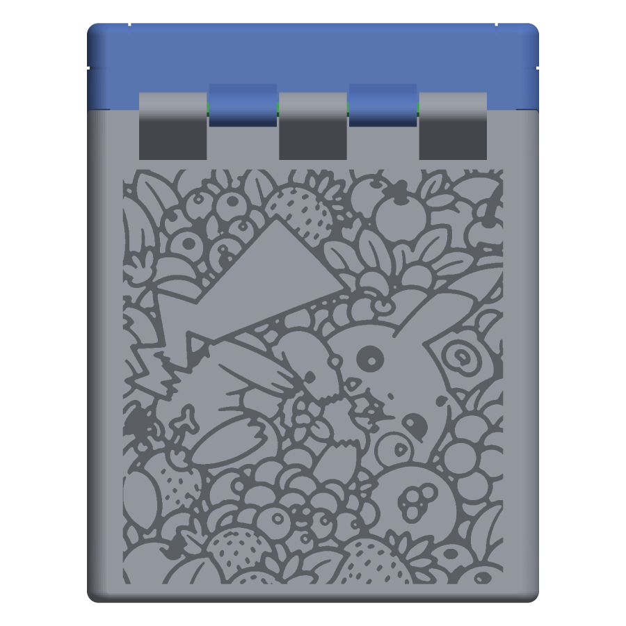
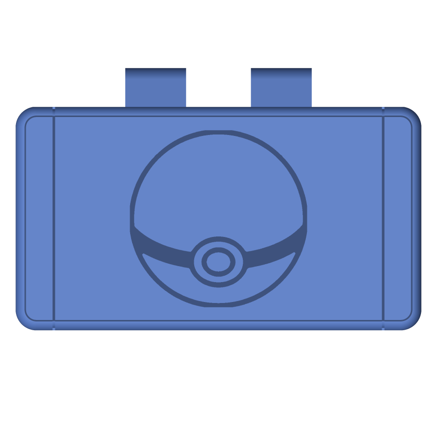
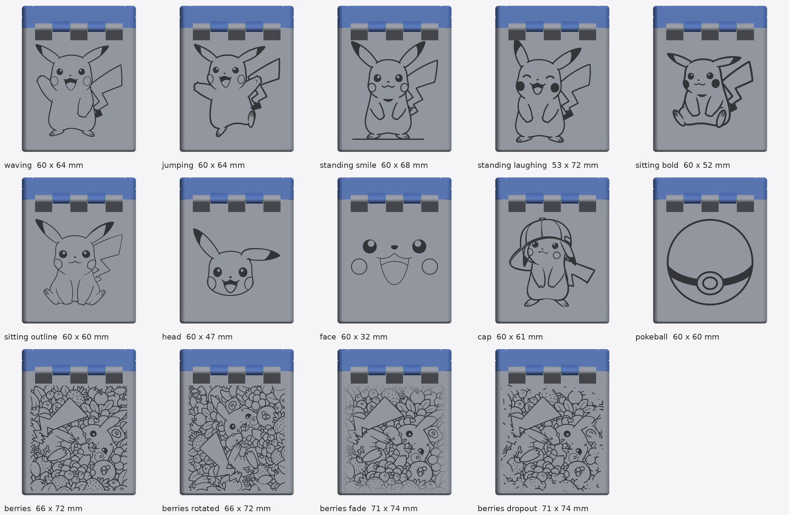

# Pikachu remix

Round 5 of the remix ([../remix/v5/](../remix/v5/)) with a Pikachu drawing engraved 0.8 mm into the back wall of the body. Each version folder holds a complete file set; only the body differs from round 5, so printing, assembly and the test coupons are as in the [round-5 README](../remix/v5/README.md). The seven are alternatives, not rounds: pick the picture you like. v7 is v6 with a second engraving on the lid's top face.

| Folder | Design on the back | Status |
|---|---|---|
| [v1_sitting_outline/](v1_sitting_outline/) | 06 sitting, outline (from the sheet image), 60 × 60 mm, a single figure with plain wall around it | Not yet test-printed |
| [v2_berries/](v2_berries/) | 11 Pikachu in berries, upright: a portrait window of the all-over drawing filling the wall top to bottom, 66 × 72 mm | Not yet test-printed |
| [v3_berries_rotated/](v3_berries_rotated/) | 12 Pikachu in berries, turned 90° so the drawing's long side runs up the box, head at the top, 66 × 72 mm | Not yet test-printed |
| [v4_berries_fade/](v4_berries_fade/) | 13 Pikachu in berries, upright, over the whole wall edge to edge (71 × 74 mm), the depth fading from 0.8 mm to nothing over the last 10 mm before each edge instead of a rectangular cutoff | Not yet test-printed |
| [v5_berries_dropout/](v5_berries_dropout/) | 14 Pikachu in berries, upright, over the whole wall edge to edge (71 × 74 mm), full depth throughout but the lines breaking into fragments and dropping out over the last 12 mm before each edge | Not yet test-printed |
| [v6_berries_pruned/](v6_berries_pruned/) | 15 Pikachu in berries, upright, over the whole wall edge to edge (71 × 74 mm), full depth throughout, thinned out over the last 14 mm before each edge by removing whole line segments while keeping every remaining line joined to the drawing | Not yet test-printed |
| [v7_berries_pruned_pokeball_top/](v7_berries_pruned_pokeball_top/) | v6's back, plus 10 the Pokéball, 34.5 mm across, engraved 0.8 mm into the top of the lid | Not yet test-printed |

| v1_sitting_outline | v2_berries | v3_berries_rotated | v4_berries_fade | v5_berries_dropout | v6_berries_pruned | v7, the top |
|---|---|---|---|---|---|---|
|  |  |  |  |  |  |  |

## The designs, previewed

The drawings in [images/pickachu/](../../images/pickachu/) were previewed on the back wall as painted-on lines, without changing the mesh, so a design can be chosen before it is cut. [00_contact_sheet.png](00_contact_sheet.png) shows them all together; each also has a straight-on `NN_*_back.png` and an iso `NN_*_back_iso.png` view in this folder. Single figures (01 to 10) are scaled to fit a 60 × 72 mm area centred on the 71 × 83 mm back wall; the all-over pattern runs over 66 × 72 mm (11, 12), nearly the whole plain wall below the hinge's support wedge, or over the whole wall with the engraving fading out in depth (13), the lines dropping out (14), or whole line segments pruned away while the drawing stays connected (15) at the edges.

| Sample | Source image | Size on the box |
|---|---|---|
| 01 waving | il_1588xN.7897305927_3qdi.webp | 60 × 64 mm |
| 02 jumping | il_1588xN.7435648637_o518.webp | 60 × 64 mm |
| 03 standing, smile | il_1588xN.8249798320_c1d0.webp | 60 × 68 mm, includes the ground line |
| 04 standing, laughing | il_1588xN.8268143871_6cok.webp | 53 × 72 mm |
| 05 sitting, bold lines | s-l1600.jpg | 60 × 52 mm |
| 06 sitting, outline | Pikachu-I-01-scaled.jpg, top left | 60 × 60 mm, engraved in [v1_sitting_outline/](v1_sitting_outline/) |
| 07 head | Pikachu-I-01-scaled.jpg, bottom right | 60 × 47 mm |
| 08 face | Pikachu-I-01-scaled.jpg, bottom left | 60 × 32 mm |
| 09 cap | 1-1.webp (516 px source, the softest lines) | 60 × 61 mm |
| 10 pokéball | Pikachu-I-01-scaled.jpg, top right | 60 × 60 mm here; 34.5 mm on the lid's top in [v7](v7_berries_pruned_pokeball_top/) |
| 11 Pikachu in berries, upright | 11_pickachu_berries_outline.png, portrait window centred on Pikachu | 66 × 72 mm, engraved in [v2_berries/](v2_berries/) |
| 12 Pikachu in berries, turned | 11_pickachu_berries_outline.png, turned 90° anticlockwise | 66 × 72 mm, engraved in [v3_berries_rotated/](v3_berries_rotated/) |
| 13 Pikachu in berries, fading | 11_pickachu_berries_outline.png, upright window over the whole wall | 71 × 74 mm, fading out at the edges, engraved in [v4_berries_fade/](v4_berries_fade/) |
| 14 Pikachu in berries, dropping out | 11_pickachu_berries_outline.png, upright window over the whole wall | 71 × 74 mm, lines breaking up at the edges, engraved in [v5_berries_dropout/](v5_berries_dropout/) |
| 15 Pikachu in berries, pruned | 11_pickachu_berries_outline.png, upright window over the whole wall | 71 × 74 mm, whole line segments removed towards the edges, drawing kept connected, engraved in [v6_berries_pruned/](v6_berries_pruned/) |

The previews are painted lines, so stroke widths are as drawn; the build thickens them to at least about 0.6 mm before cutting. The previews come from [tools/pickachu_samples.py](../../tools/pickachu_samples.py), which holds the crop boxes and placement, and the engraved files from [tools/pickachu_build.py](../../tools/pickachu_build.py), which takes the design index (0 for 01, 14 for 15), the output folder and optionally `top=<index>` for a second drawing on the lid's top face; a design with a fade width set is cut as nested depth steps, one with a drop-out width has its lines cut by a seeded random field first, and one with a prune width has whole junction-to-junction segments removed with the network kept connected.
