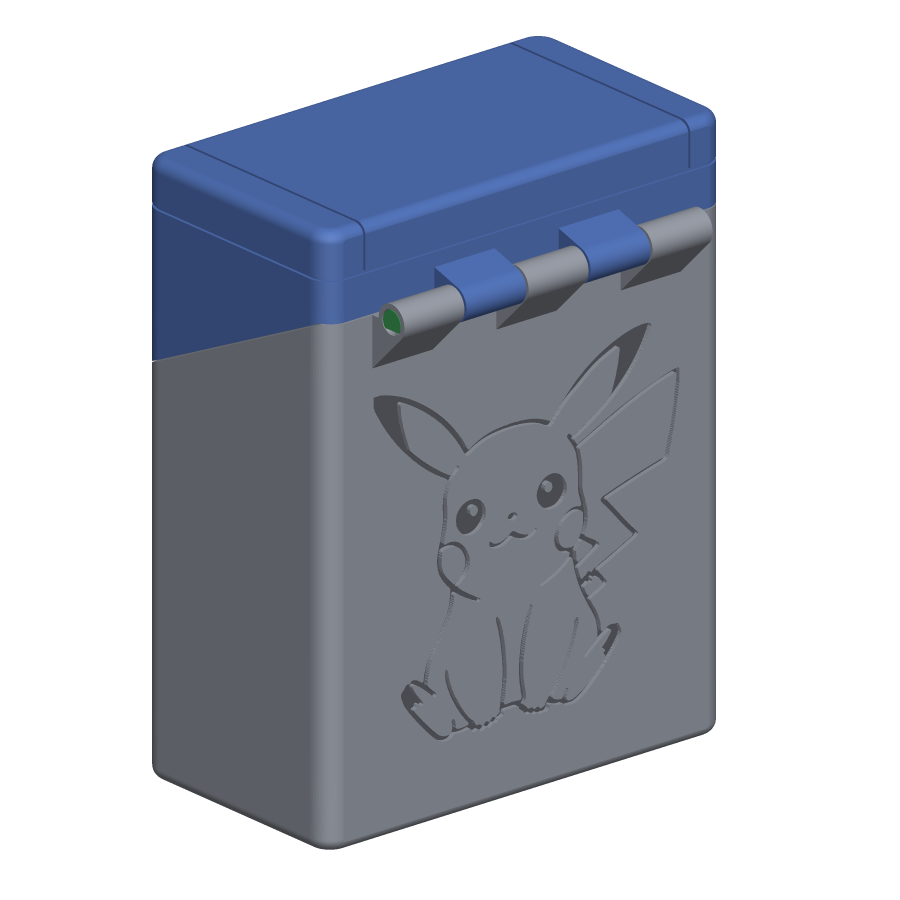
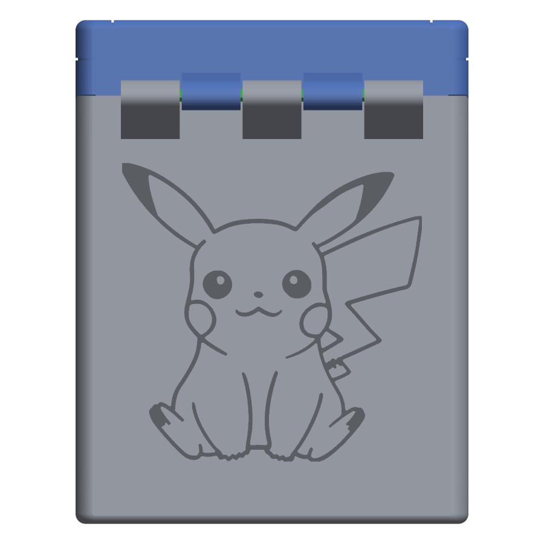
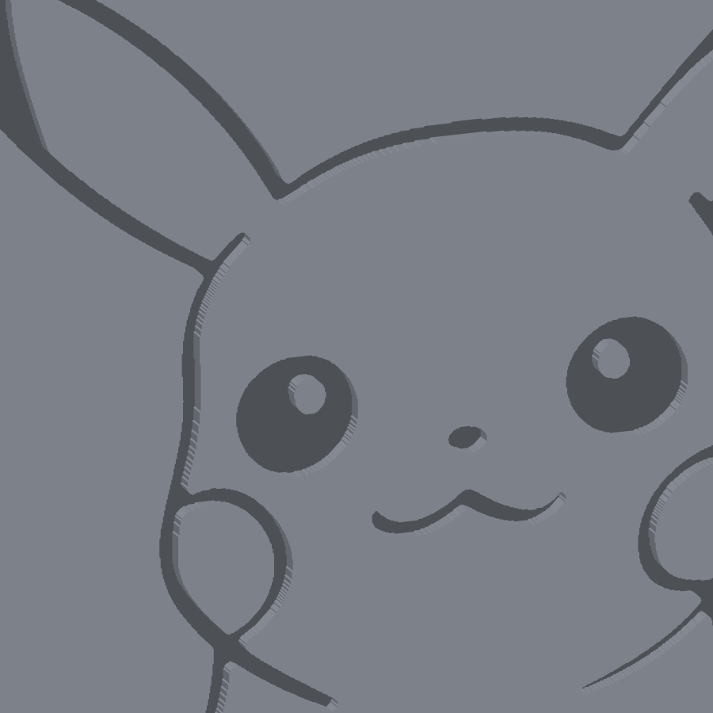

# Pikachu remix, version 1: sitting outline

The round-5 remix ([../../remix/v5/](../../remix/v5/)) with a sitting Pikachu engraved 0.8 mm into the back wall of the body. Every file except the body is a byte-for-byte copy of round 5, so printing, assembly and the test coupons are exactly as described in the [round-5 README](../../remix/v5/README.md); the body changes only in the outer 0.8 mm of its back wall.

| File | Print orientation | What it is |
|---|---|---|
| Case-bottom_remix.stl | Upright, open top facing up | Round-5 body with Pikachu engraved 0.8 mm deep in the back wall; "Yoojin" is still in the bottom |
| Case-top_remix.stl | Front face (screen bezel) on the bed | Lid, unchanged |
| Hinge-pin_remix.stl | Lying on its flat side | Hinge pin, print two, unchanged |
| D-Pad_remix.stl, Button_remix.stl, StartSelect_remix.stl | As in round 5 | Buttons, unchanged |
| Test-seats.stl, Test-hinge-body.stl, Test-hinge-lid.stl | As in round 5 | Optional fit-test coupons, unchanged |

## The engraving

- **Design:** the sitting outline Pikachu, design 06 of the samples in [the folder above](../README.md), cut from the sheet image `Pikachu-I-01-scaled.jpg` in [images/pickachu/](../../../images/pickachu/).
- **Size and place:** 60 × 60 mm, centred on the width of the back wall, from 12 to 72 mm above the base. The back wall is 71 × 83 mm, so there is about 5.5 mm of plain wall around the picture and the hinge knuckles above are untouched.
- **Depth:** 0.8 mm, like the "Yoojin" engraving in the bottom. The back wall is 3.95 mm thick, so 3.15 mm of wall remains behind the picture.
- **Line width:** the drawing's strokes were thickened so the narrowest groove is 0.56 mm and the median 0.8 mm. Gaps between strokes narrower than 0.45 mm were merged, and any solid left between two grooves thinner than 0.4 mm (a few wedges where the ear fills meet the outline) was taken into the groove, so there is nothing in the picture a 0.4 mm nozzle cannot print.
- **Printing:** the picture is on a vertical wall, so it prints as a shallow recess with no supports. The top edge of each groove overhangs by 0.8 mm, which is fine at 0.2 mm layers; if your printer droops on such steps, 0.12 to 0.16 mm layers make the picture crisper. There are no first-layer islands to worry about, unlike the engraving in the bottom.

| | |
|---|---|
|  |  |

[04_engraving_raking_light.png](example_images/04_engraving_raking_light.png) shows the picture lit from the side, the way the grooves will catch the light.

Built from round 5 by [tools/pickachu_build.py](../../../tools/pickachu_build.py), which turns the drawing into polygons, extrudes them through the wall surface and subtracts them from the body, then checks the result (watertight; removed volume equals the picture's area times 0.8 mm; nothing added; all changes inside the back wall). Not yet test-printed.

To put a different drawing on the back, see the [folder README](../README.md): the previews of all ten designs are there, and the build script takes the design's index.
