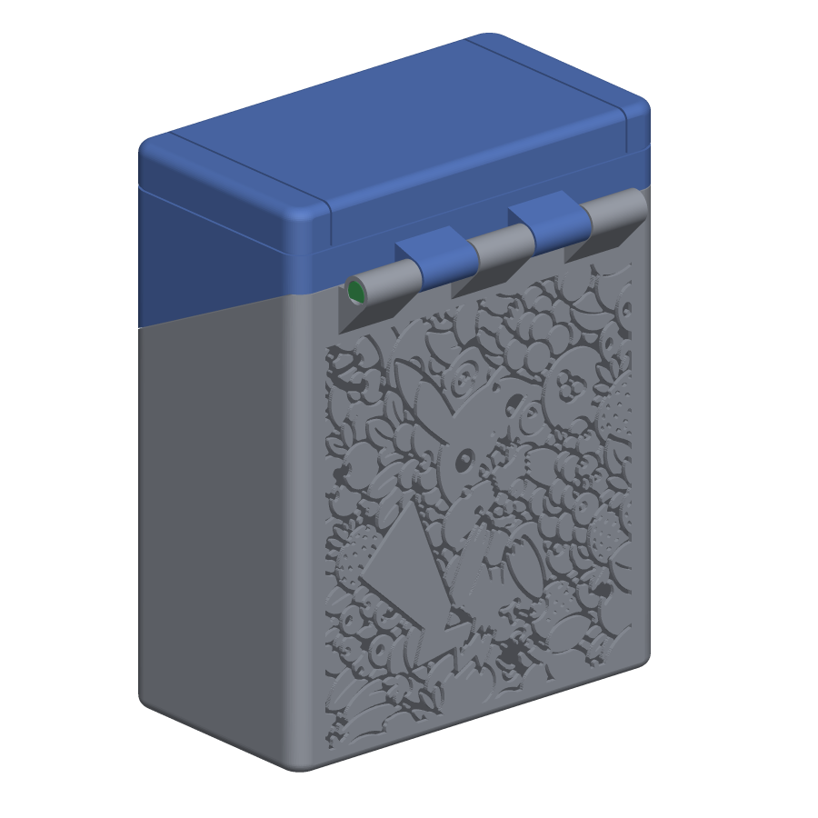
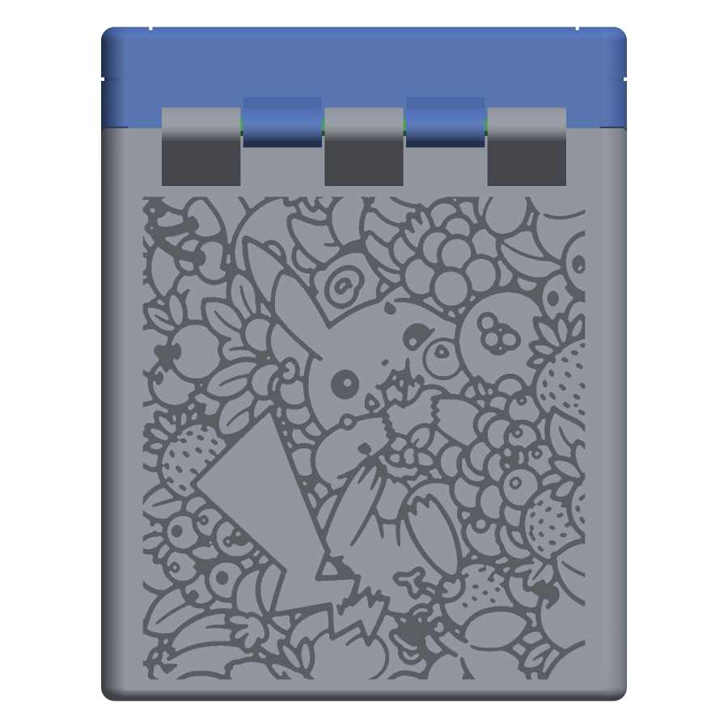
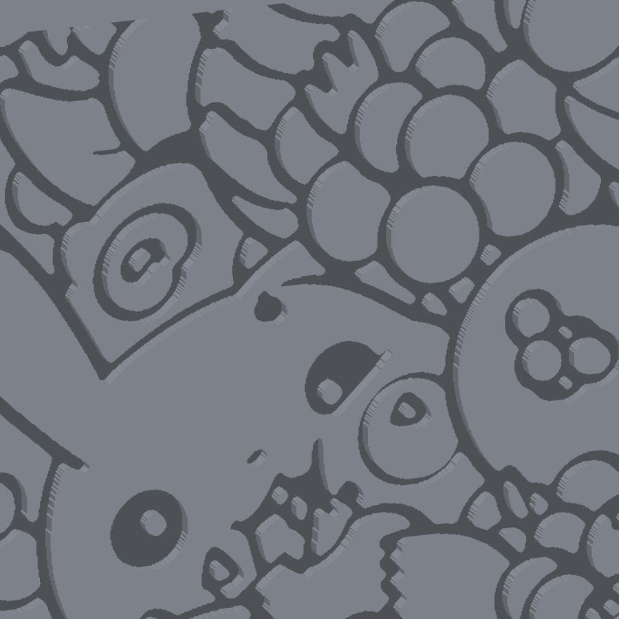

# Pikachu remix, version 3: Pikachu in berries, turned

The round-5 remix ([../../remix/v5/](../../remix/v5/)) with a Pikachu-in-berries pattern engraved 0.8 mm into the back wall of the body. Every file except the body is a byte-for-byte copy of round 5, so printing, assembly and the test coupons are exactly as described in the [round-5 README](../../remix/v5/README.md); the body changes only in the outer 0.8 mm of its back wall.

| File | Print orientation | What it is |
|---|---|---|
| Case-bottom_remix.stl | Upright, open top facing up | Round-5 body with the pattern engraved 0.8 mm deep in the back wall; "Yoojin" is still in the bottom |
| Case-top_remix.stl | Front face (screen bezel) on the bed | Lid, unchanged |
| Hinge-pin_remix.stl | Lying on its flat side | Hinge pin, print two, unchanged |
| D-Pad_remix.stl, Button_remix.stl, StartSelect_remix.stl | As in round 5 | Buttons, unchanged |
| Test-seats.stl, Test-hinge-body.stl, Test-hinge-lid.stl | As in round 5 | Optional fit-test coupons, unchanged |

## The engraving

- **Design:** 12 berries, rotated: the same drawing turned 90° anticlockwise so its long side runs up the box and Pikachu's head is at the top, cropped to rows 201 to 1318 of the turned image to match the wall's shape. Source: `11_pickachu_berries_outline.png` in [images/pickachu/](../../../images/pickachu/); preview [12_berries_rotated_back.png](../12_berries_rotated_back.png).
- **Size and place:** 66 × 72 mm, from 3 to 75 mm above the base and 2.6 mm in from each side, which is nearly the whole plain wall. The 45° support wedge under the hinge knuckles meets the wall at 76.4 mm, so the pattern stops below it; running higher would cut hidden tunnels inside the wedge.
- **Depth:** 0.8 mm, like the "Yoojin" engraving in the bottom. The back wall is 3.95 mm thick, so 3.15 mm remains behind the picture.
- **Line width:** strokes thickened by 0.15 mm a side: the narrowest groove is 0.46 mm and the median 0.75 mm. Gaps under 0.45 mm were merged and any solid between two grooves thinner than 0.4 mm was taken into the groove. The pattern is dense, so about 1630 mm² of the wall is recessed; the engraving is more a texture than a line drawing and reads best in side light ([04_engraving_raking_light.png](example_images/04_engraving_raking_light.png)).
- **Printing:** vertical wall, shallow recess, no supports, no first-layer islands. Each groove's top edge overhangs 0.8 mm, fine at 0.2 mm layers; 0.12 to 0.16 mm layers make the small berries crisper.

| | |
|---|---|
|  |  |

Built from round 5 by [tools/pickachu_build.py](../../../tools/pickachu_build.py) (design index 11, output folder v3_berries_rotated) and checked: watertight, removed volume equals the pattern's area times 0.8 mm, nothing added, all changes inside the back wall. Not yet test-printed. The other versions and all design previews are in the [folder README](../README.md).
