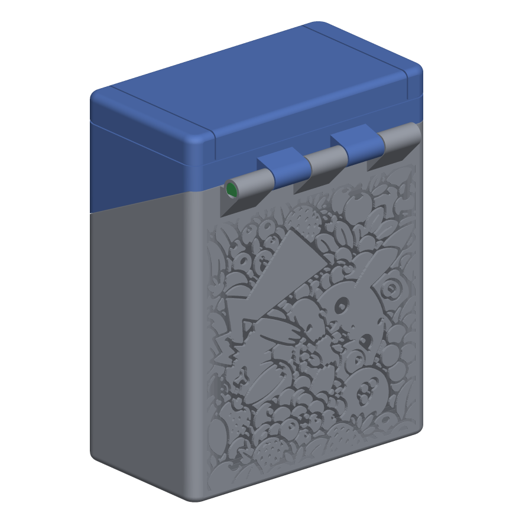
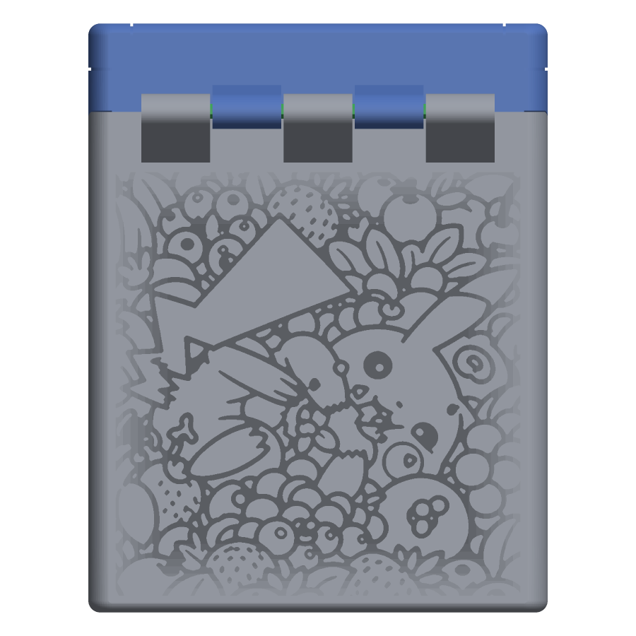
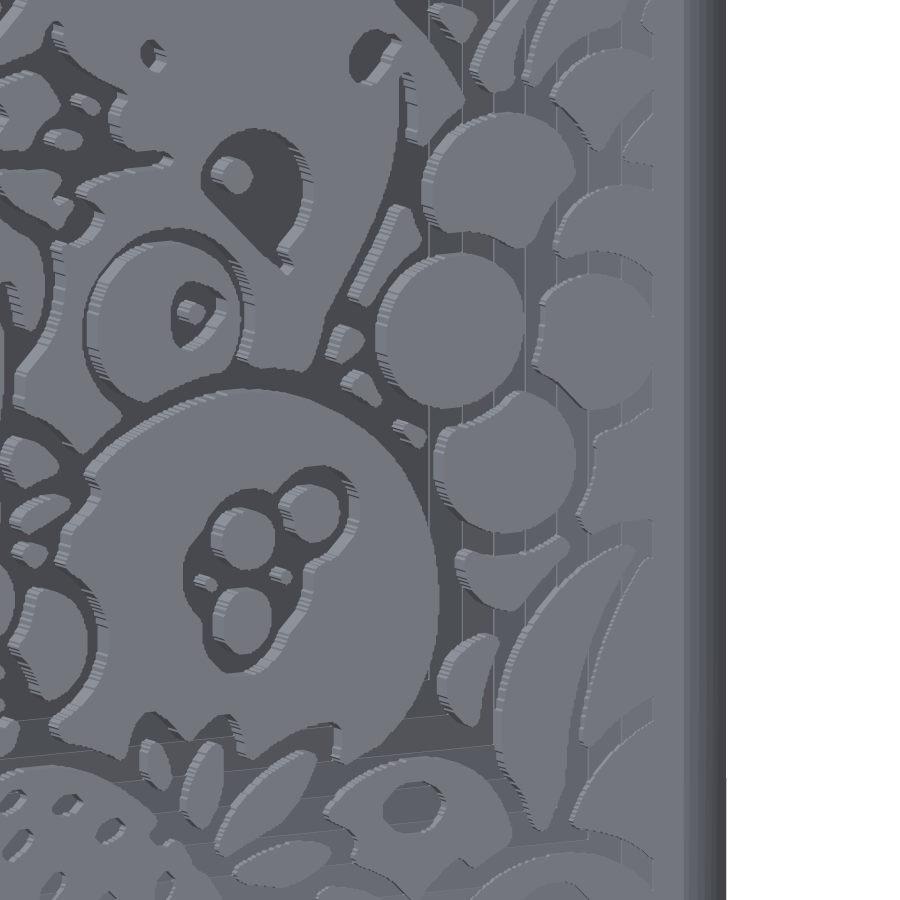

# Pikachu remix, version 4: Pikachu in berries, edge to edge with a fade

The round-5 remix ([../../remix/v5/](../../remix/v5/)) with the Pikachu-in-berries pattern engraved into the whole back wall of the body, 0.8 mm deep in the middle and fading to nothing at the edges. Every file except the body is a byte-for-byte copy of round 5, so printing, assembly and the test coupons are exactly as described in the [round-5 README](../../remix/v5/README.md); the body changes only in the outer 0.8 mm of its back wall.

| File | Print orientation | What it is |
|---|---|---|
| Case-bottom_remix.stl | Upright, open top facing up | Round-5 body with the fading pattern in the back wall; "Yoojin" is still in the bottom |
| Case-top_remix.stl | Front face (screen bezel) on the bed | Lid, unchanged |
| Hinge-pin_remix.stl | Lying on its flat side | Hinge pin, print two, unchanged |
| D-Pad_remix.stl, Button_remix.stl, StartSelect_remix.stl | As in round 5 | Buttons, unchanged |
| Test-seats.stl, Test-hinge-body.stl, Test-hinge-lid.stl | As in round 5 | Optional fit-test coupons, unchanged |

## The engraving

- **Design:** 13 berries, fade: the same upright window of the all-over drawing as [v2](../v2_berries/) (columns 270 to 1250 of the 1536 px source), but scaled over the whole flat wall, 71 × 74 mm, from 1.6 to 76 mm above the base and right out to the rounded side edges. Preview [13_berries_fade_back.png](../13_berries_fade_back.png).
- **Fade:** the depth is 0.8 mm wherever the picture is more than 10 mm from an edge of the wall (the middle 51 × 54 mm) and falls off linearly to zero at the edge, so there is no rectangular boundary; the grooves just get shallower until they vanish into the surface. The ramp is cut as eight nested steps of 0.1 mm; each step is 1.25 mm wide, far below what a print shows. The top edge of the fade is the 45° support wedge under the hinge knuckles, which meets the wall at 76.4 mm.
- **Depth and wall:** 0.8 mm at most, into a 3.95 mm wall, so at least 3.15 mm remains behind the picture.
- **Line width:** strokes thickened by 0.15 mm a side: the narrowest groove is 0.52 mm and the median 0.85 mm. Gaps under 0.45 mm were merged and any solid between two grooves thinner than 0.4 mm was taken into the groove.
- **Printing:** vertical wall, shallow recess, no supports, no first-layer islands. The deepest grooves overhang 0.8 mm at their top edges, fine at 0.2 mm layers; 0.12 to 0.16 mm layers make the small berries and the fade smoother.

| | |
|---|---|
|  |  |

[03_engraving_close_up.png](example_images/03_engraving_close_up.png) is Pikachu's face at full depth; [04_engraving_raking_light.png](example_images/04_engraving_raking_light.png) is the whole wall lit from the side.

Built from round 5 by [tools/pickachu_build.py](../../../tools/pickachu_build.py) (design index 12, output folder v4_berries_fade) and checked: watertight, removed volume equals the stepped depth summed over the pattern (1043.5 mm³), nothing added, all changes inside the back wall. Not yet test-printed. The other versions and all design previews are in the [folder README](../README.md).
