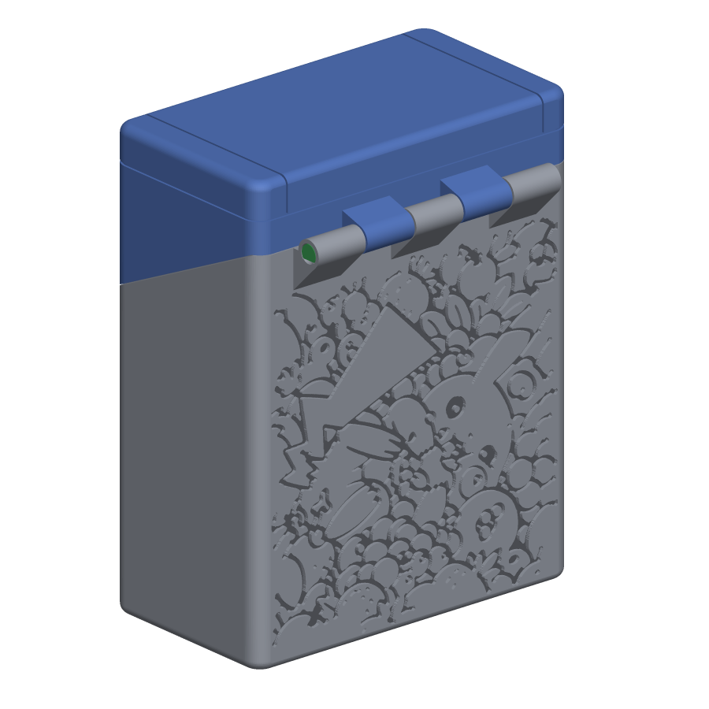
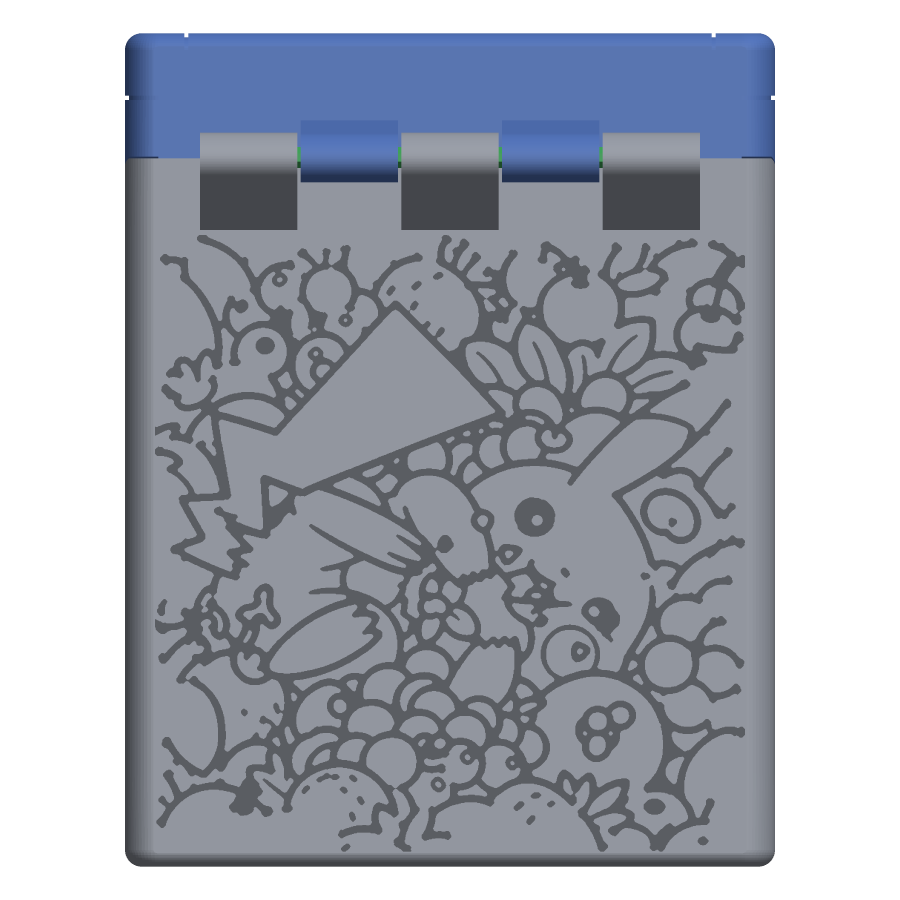
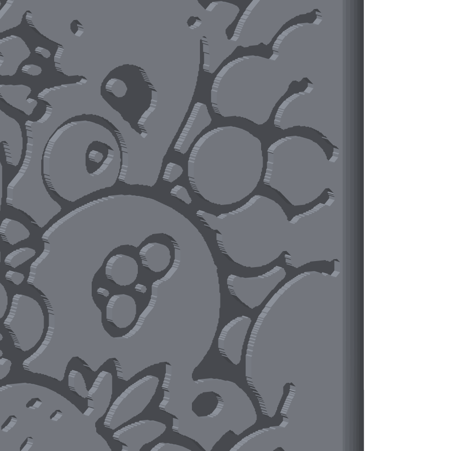

# Pikachu remix, version 6: Pikachu in berries, edge to edge, thinned out but still joined

The round-5 remix ([../../remix/v5/](../../remix/v5/)) with the Pikachu-in-berries pattern engraved 0.8 mm into the whole back wall of the body, complete in the middle and thinning out towards the edges while every line stays joined to the drawing. Every file except the body is a byte-for-byte copy of round 5, so printing, assembly and the test coupons are exactly as described in the [round-5 README](../../remix/v5/README.md); the body changes only in the outer 0.8 mm of its back wall.

| File | Print orientation | What it is |
|---|---|---|
| Case-bottom_remix.stl | Upright, open top facing up | Round-5 body with the thinned pattern in the back wall; "Yoojin" is still in the bottom |
| Case-top_remix.stl | Front face (screen bezel) on the bed | Lid, unchanged |
| Hinge-pin_remix.stl | Lying on its flat side | Hinge pin, print two, unchanged |
| D-Pad_remix.stl, Button_remix.stl, StartSelect_remix.stl | As in round 5 | Buttons, unchanged |
| Test-seats.stl, Test-hinge-body.stl, Test-hinge-lid.stl | As in round 5 | Optional fit-test coupons, unchanged |

## The engraving

- **Design:** 15 berries, pruned: the same upright window of the all-over drawing as [v2](../v2_berries/), [v4](../v4_berries_fade/) and [v5](../v5_berries_dropout/) (columns 270 to 1250 of the 1536 px source), over the whole flat wall, 71 × 74 mm, from 1.6 to 76 mm above the base and out to the rounded side edges. Preview [15_berries_pruned_back.png](../15_berries_pruned_back.png).
- **Thinning:** every groove is the full 0.8 mm deep and no line is cut mid-way. The drawing is treated as a network of 929 line segments running from junction to junction. More than 14 mm from an edge nothing is touched. Closer in, whole segments are removed with a chance that rises towards the edge, but a segment is only removed if the lines it joined stay connected to each other without it; the 131 segments that would have split the drawing were kept. 229 segments went, so towards the edges the berries and leaves lose some of their outlines and the pattern opens up into a web that is still one connected drawing. Isolated dots near the edge (seeds, highlights) go whole or stay whole. The random choice is seeded, so the build is repeatable.
- **Depth and wall:** 0.8 mm into a 3.95 mm wall, so 3.15 mm remains behind the picture. The top edge is set by the 45° support wedge under the hinge knuckles, which meets the wall at 76.4 mm.
- **Line width:** strokes thickened by 0.15 mm a side: the narrowest groove is 0.52 mm and the median 0.87 mm. Gaps under 0.45 mm were merged and any solid between two grooves thinner than 0.4 mm was taken into the groove.
- **Printing:** vertical wall, shallow recess, no supports, no first-layer islands. Each groove's top edge overhangs 0.8 mm, fine at 0.2 mm layers; 0.12 to 0.16 mm layers make the small berries crisper.

| | |
|---|---|
|  |  |

[03_engraving_close_up.png](example_images/03_engraving_close_up.png) is Pikachu's face; [04_engraving_raking_light.png](example_images/04_engraving_raking_light.png) is the whole wall lit from the side. Compare [v4](../v4_berries_fade/) (all lines kept, depth fading) and [v5](../v5_berries_dropout/) (lines cut into fragments).

Built from round 5 by [tools/pickachu_build.py](../../../tools/pickachu_build.py) (design index 14, output folder v6_berries_pruned) and checked: watertight, removed volume equals the surviving pattern's area times 0.8 mm (1219.2 mm³), nothing added, all changes inside the back wall. Not yet test-printed. The other versions and all design previews are in the [folder README](../README.md).
