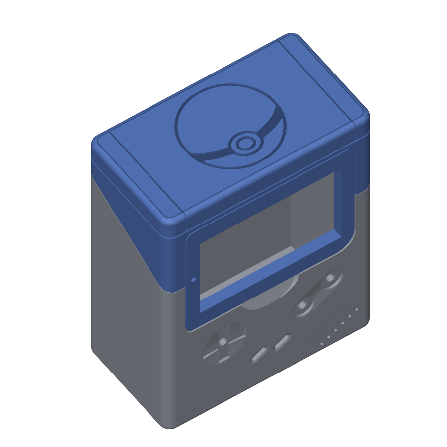
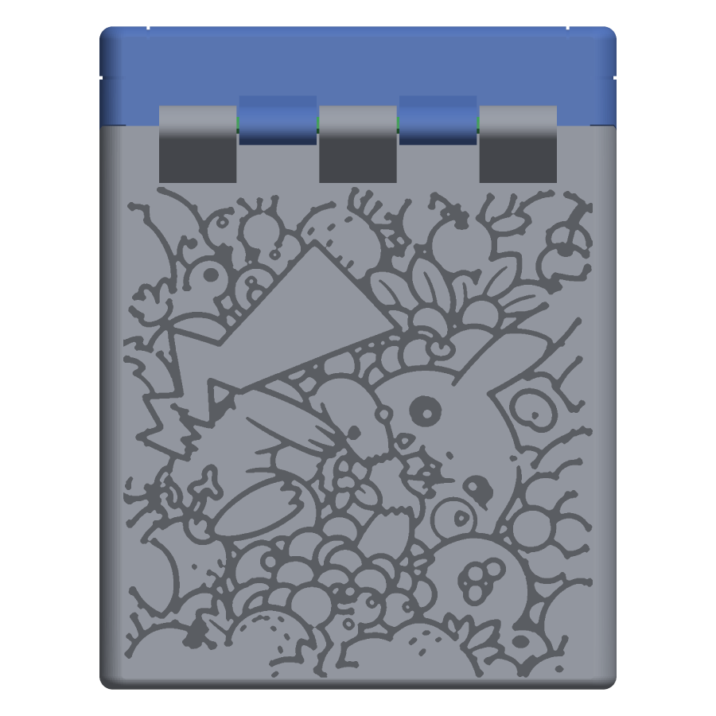

# Pikachu remix, version 7: v6 plus a Pokéball on top

[v6](../v6_berries_pruned/), the round-5 remix with the thinned Pikachu-in-berries pattern engraved into the back wall, with a Pokéball engraved 0.8 mm into the top of the lid as well. The body is byte-for-byte v6's; the lid is round 5's with the engraving in its top face; the pin, buttons and test coupons are byte-for-byte copies of round 5. Printing, assembly and the coupons are exactly as described in the [round-5 README](../../remix/v5/README.md).

| File | Print orientation | What it is |
|---|---|---|
| Case-bottom_remix.stl | Upright, open top facing up | v6's body: the thinned berries pattern in the back wall, "Yoojin" in the bottom |
| Case-top_remix.stl | Front face (screen bezel) on the bed | Lid with the Pokéball engraved 0.8 mm into its top face; otherwise round 5's |
| Hinge-pin_remix.stl | Lying on its flat side | Hinge pin, print two, unchanged |
| D-Pad_remix.stl, Button_remix.stl, StartSelect_remix.stl | As in round 5 | Buttons, unchanged |
| Test-seats.stl, Test-hinge-body.stl, Test-hinge-lid.stl | As in round 5 | Optional fit-test coupons, unchanged |

## The Pokéball

- **Design:** 10 pokéball from the sheet image (preview [10_pokeball_back.png](../10_pokeball_back.png) shows the same drawing on the back wall).
- **Where:** the top of the box, the end of the lid above the screen, which is a flat 39.6 × 74.6 mm face. The ball is 34.5 mm across, centred side to side and 2.5 mm in from the front and back edges of the flat face. Seen from the front of the box looking down, it is the right way up.
- **Depth:** 0.8 mm. The lid's top is 2.0 mm thick, so 1.2 mm remains, the same floor as under the "Yoojin" engraving in the body's bottom.
- **Line width:** the narrowest groove is 0.86 mm and the median 0.96 mm; the band across the middle is a 3 mm wide recess.
- **Printing:** the lid prints face down, so its top face stands vertical on the bed and the Pokéball is a recess in a vertical wall: no supports, no islands, and the 3 mm band's upper edge overhangs 0.8 mm, which is fine at 0.2 mm layers.

| | |
|---|---|
|  |  |

The back wall is v6's; see the [v6 README](../v6_berries_pruned/README.md) for how the pattern is thinned towards the edges while staying connected. Its close-ups are repeated here as 02 to 05.

Built by [tools/pickachu_build.py](../../../tools/pickachu_build.py) with design 14 on the back, output folder v7_berries_pruned_pokeball_top and `top=9`. Checked: both meshes watertight, nothing added, the removed volumes equal the drawings' areas times 0.8 mm, the lid changes only inside its top face and the body is identical to v6's. Not yet test-printed. The other versions and all design previews are in the [folder README](../README.md).
